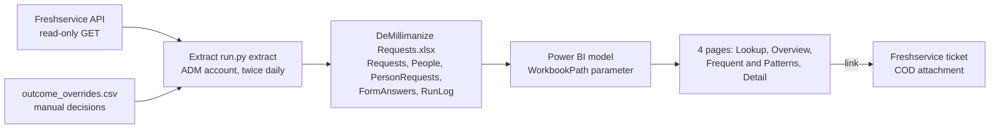

# Project Overview

> **This file must be updated with every change.** See [AGENTS.md](AGENTS.md#8-required-on-every-change).

**Last updated:** 2026-11-24

## Current status

**Phase:** Building, stage 2. Michael's Power BI specification has been merged into the project. The full extract (Freshservice → Excel workbook in Michael's schema), a fake-data workbook, the Power BI model script, the theme and the build guide are written.

- **Tested:** 45 unit tests pass, including a full extract run against a fake Freshservice client. Excel opens the mock workbook with all 5 named tables. The TMDL model applied and refreshed in Power BI Desktop with mock data. The live probe worked against the correct host.
- **Not tested:** the 4 generated report pages (`python run.py pages`) have not been opened in Power BI Desktop yet; the full live extract has not been run.

## Requirements summary

| # | Requirement | Priority | Status |
|---|---|---|---|
| R1 | Search by employee name (as requester **and** as recipient) | Must | Model done (People + PersonRequests); page not built |
| R2 | Show request date and outcome (Approved / Denied / Pending / Needs Review) per request | Must | Extract done; page not built |
| R3 | Pull De-Millimanize tickets from Freshservice (read-only), both form and legacy | Must | Code done; not run live |
| R4 | Total count of completed De-Millimanize tickets | Should | Measures done |
| R5 | Flag repeat requests within 120 days (Frequent) | Should | Extract done |
| R6 | Requests by practice (AD practice of the person receiving the device) | Nice | Extract done; page not built |
| R7 | Requests by device type | Nice | Extract done; page not built |
| R8 | Link to the ticket's Certificate of Destruction | Nice | Ticket URL and certificate flags done |
| R9 | Abuse patterns: holiday season, devices for others, duplicate serials (from Michael's spec) | Should | Extract and measures done; page not built |
| R10 | Data quality and refresh health: Needs Review worklists and RunLog (from Michael's spec) | Should | Extract and measures done; page not built |

## Architecture

**Chosen by Kevin (2026-11-19), merged with Michael's specification:** an extract script writes an Excel workbook, and Power BI only reads that workbook.

Why there's an extract step instead of Power BI calling the API:

- **API key:** The key is personal and stored in a Windows environment variable. Power BI can't read environment variables, but a script can. Viewers never need a key.
- **Legacy tickets:** Finding them takes fuzzy matching and a review list. That's much easier to write and test in a script than in Power Query.
- **Business rules:** Outcome, Frequent and technician handling are computed once in tested Python. Power BI surfaces them and never recomputes them.

Trade-off: someone has to run the script, or schedule it on a machine, to refresh the data.

**Runtime:** Python 3.13, installed machine-wide at `C:\Program Files\Python313` (on the machine PATH, so the ADM account can use it). The only dependency is **openpyxl 3.1.5**, pinned in `requirements.txt`. It's needed to write Excel tables and was already installed machine-wide (checked 2026-11-19). `uv` isn't used because it's installed per-user and the ADM account can't reach it.

### Workbook (data contract with Power BI)

- **File:** `DeMillimanize Requests.xlsx`. It's in `data\` for now (git-ignored). The target is the CMH IT SharePoint library (folder still to be confirmed).
- **Tables:** `Requests`, `People`, `PersonRequests`, `FormAnswers`, `RunLog`. Column names follow Michael's specification exactly, and the list lives in `extract/tables.py`.
- **Additions to Michael's columns:**
  - `Requests`: `Requester Is Technician`, `Recipient Is Technician`
  - `People`: `Technician`
  - `RunLog`: `Finished (Local)`, used for the "Last refreshed" label
- **State:** `data\state\` holds the cached tickets and the run history used for incremental runs.

### Power BI (`powerbi/`)

- **`DeMillimanize.model.tmdl`:** A model script pasted into Desktop's TMDL view. It contains the tables, Power Query, DimDate, GapBuckets, 40+ measures, 4 relationships and the RLS role. It's generated from the schema by `python run.py tmdl`.
- **`DeMillimanize.theme.json`:** Freshservice-style theme (navy `#12344D`, teal `#00C1A0`, outcome colors).
- **`GUIDE.md`:** Setup, a page-by-page build guide, publish/refresh/share steps, the validation checklist and assumptions.
- **Relationships:**
  - People → PersonRequests (single direction)
  - PersonRequests ↔ Requests (both directions, so a selected person filters Requests)
  - DimDate → Requests on Created Date
  - Requests → FormAnswers
- **Fake data:** `sample_data/make_mock_workbook.py` creates a **fake** workbook so the report can be built now.

### Refreshing the data (decided 2026-11-19)

- **Scheduled:** `tools\schedule-extract.cmd` creates two Task Scheduler tasks (05:30 and 12:30) that run the extract as the ADM account. Written but not run yet.
- **Power BI Service:** Schedule the refresh at 06:00 and 13:00, after the extract.
- **Power BI Desktop Refresh button:** It reloads the latest workbook. Power BI stays on the standard account.
- **"Run extract now":** `tools\run-extract.cmd` runs the extract as the ADM account on demand, before clicking Refresh.
- **Run modes:** The first run is **Full** (tickets updated since 2015-01-01). Later runs are **Incremental** (since the last success, minus 2 days). `run.py extract --full` forces a full run. A failed run keeps the previous data and logs "Failed" in RunLog.

Power BI reports show the data from the **last refresh**. They don't fetch new data just because someone opens the report.

**API key and the ADM account:** The key is in the `FRESHSERVICE_API_KEY` **user** environment variable of the **Kevin.ConcepcionADM** account. Scripts that call the API must run as that account. Power BI does **not** need to.

**Project folder and the ADM account:** `O:\` is Kevin's home share (`\\milw-isilon-prod-smb.milliman.com\milwh-users$\kevin.concepcion`). Drive letters are per-user, so the ADM account has to use the **UNC path**. We still need to confirm the ADM account can read and write there; the probe will show this.

**Freshservice URL:** The API host is **`https://milliman-helpdesk.freshservice.com`**, confirmed from SPARK's source (`O:\Notes\SPARK Freshservice API Connection.md`). The first probe run used `https://hd.milliman.com`, which is the **portal** address, and got HTTP 404. That was the cause of the failure. The host can be overridden with `FRESHSERVICE_BASE_URL`. If the server redirects, the client stops and reports the target host, because following a redirect would send the API key to another server.

**First probe run (2026-11-19):** The launcher worked and the ADM account read `FRESHSERVICE_API_KEY`. The UNC path worked. The call failed with 404 because of the wrong host (see above).

**Second probe run (2026-11-20), against `milliman-helpdesk.freshservice.com`:** This run **worked**. Results (field names and types only):

- **Reads that succeeded:**
  - The key belongs to an agent.
  - 81,015 tickets created since 2015.
  - Ticket 653455, with its requested items, approvals, conversations and the normalized bundle.
- **Status choices:** 2 Open, 3 Pending, 4 Resolved, 5 **Closed**, 6 Waiting on Approval, 7 Waiting on GCS, 8 Approved, 9 Waiting on Child Ticket, 10 Waiting on Requester Response.
- **`GET /agents` returns HTTP 403** with this key. Technicians are therefore also taken from **ticket assignees** (`responder_id`); the procedure has the technician assign the form ticket to themselves.
- **The ticket list includes `description_text`**, so older tickets that only mention De-Millimanize in the description are found.
- **"Computer provided to" is a user ID** (`computer_provided_to`, no numeric suffix on this item). It resolves to a name and email **only when it matches the ticket's requester or requested-for**. Any other ID can't be looked up while person reads return 403, so it shows as "Unknown user (ID n)".
- **Certificate PDF:** it's attached to the **requested item**, not the ticket. The extract now reads both.
- **Ticket-level approval:** the ticket has `approval_status_name`. It's used when the approvals list is empty.
- **Person and department reads are denied (HTTP 403):** `/requesters/{id}`, `/agents/{id}` and `/departments/{id}` all return 403 with this key (probe lookups step, 2026-11-20). Names and emails still come from the ticket itself (`include=requester,requested_for`). The extract stops calling a lookup after its first 403, so denied calls don't use up the rate limit.

**Lessons from the Spark project** (from SPARK's source, summarized in `O:\Notes\SPARK Freshservice API Connection.md`, branch `SPARK-PCR-KEVIN`):

- SPARK calls these GET paths: `/agents/me`, `/tickets/{id}`, `/tickets/{id}/requested_items` (form answers are under `custom_fields`), `/tickets/{id}/conversations?per_page=100&page=N`, `/requesters/{id}` and `/departments/{id}`. **`/requesters/{id}` and `/departments/{id}` return 403 with this key, in SPARK too.** SPARK's latest commit explains these 403s to agents as missing permission to look up the employee's profile.
- **How SPARK works around it:**
  - A **local department table** (`Services/DriveMappings.cs`, 18 department IDs). It calls `/departments/{id}` only for IDs that aren't in the table.
  - **Practice from Active Directory** (`Services/AdUserPracticeLookupService.cs`): find the user by email or name, then take the practice OU code (for example `OU=CMH` → `CMH`) from their distinguished name, using `GroupMappings.PracticeToAdminOUMap`. This project copies both.
- **Status numbers SPARK uses:** 2 Open, 3 Pending, 4 Resolved, 6 Waiting on Customer, and 8 In Progress. The number for Closed isn't in SPARK, so the probe's status list will confirm it.
- SPARK's queries are limited to one agent and read only the first page. The dashboard needs all agents plus paging.
- Spark's API key could **submit** service requests but **couldn't read catalog definitions**. Our key may have similar read limits.
- Service-request custom field names get item-specific suffixes from Freshservice (for example `_252801`).

### Freshservice API facts (from official docs, api.freshservice.com, 2026-11-19)

- Authentication: HTTP Basic, with the API key as the username and `X` as the password.
- `GET /api/v2/tickets`: Returns only the **last 30 days** by default, so older tickets need `updated_since`. It can filter with `type=Service Request`. Up to `per_page=100` results per page, with the next page given in the `Link` header. Embedding extra data with `include` costs 2 extra API credits per resource.
- The list endpoint's predefined filters are `new_and_my_open`, `watching`, `spam`, and `deleted`. There is **no archived filter**, so whether archived tickets can be reached is still open. The probe tests this.
- `GET /api/v2/tickets/filter?query=...` can't search the subject. It returns a `total` count and 30 results per page.
- `GET /api/v2/tickets/[id]?include=conversations` returns up to 10 conversations. `include=ticket_attachments` returns attachment details.
- HTTP 429 means the rate limit was exceeded. The client waits for `Retry-After` and then retries.
- **Not yet confirmed (the probe checks these):** the exact paths for requested items (`/tickets/[id]/requested_items`), ticket fields (`/ticket_form_fields`), and agents (`/agents`).

- **Data source:** Freshservice API, read-only. Access was first set up through Spark.
- **Visualization:** Power BI. Power BI Desktop is installed on the developer machine (checked 2026-11-19).
- **Source format:** Power BI Project (`.pbip`) instead of `.pbix`, so the report is stored as text files that git can track and compare.
- **Authentication:** Microsoft sign-in through the Power BI Service. Only people the report is shared with can open it.
- **Certificates of Destruction:** The dashboard links to the Freshservice ticket, and the COD is opened there. The dashboard does not copy or store the PDFs.

## De-Millimanize policy (summary)

This comes from the internal IT policy note, last updated 2021.

- **Who can ask:** An employee whose old laptop is being replaced, or who is retiring or leaving Milliman. The program is **not advertised**.
- If the laptop is past warranty and going to a Milliman employee, the user needs **supervisor approval**.
- Requests from retiring EPs (SEAT) are approved.
- The laptop is fully wiped and has only the Windows operating system afterward.
- *Older guidance:* The employee may need to pay shipping to receive the laptop.

This is why Shannon wants to see repeat requests. Frequent asks from the same person go against the purpose of the program.

## Freshservice data (from ticket screenshots)

There are **two kinds** of De-Millimanize tickets.

### 1. Form-based tickets (current process)

| Item | What we saw |
|---|---|
| Ticket type | Service Request (`SR-` prefix) |
| Subject pattern | `Request for <Name> : "De-Millimanize" Device with Milliman Data` |
| Requested item | `"De-Millimanize" Device with Milliman Data` (service catalog item) |
| Form fields | PC Serial Number, PC Make and Model, Most recent PC Name, **Computer provided to** |
| COD | PDF attached to the ticket, named `Certificate-<OldPCName>-<ComputerID>-<SerialNumber>-<Status>-<YYYY-MM-DD>-<HH-mm-ss>.pdf` |
| Group / Department | CMH Health IT Support / CMH Health |
| Category | The procedure says *Ticket Management > User resolved issue*, but at least one ticket uses *Hardware > Laptop*. **Category is not reliable for filtering.** |
| Resolution notes | `Demillimanized laptop for <Name>` (by procedure) |

**Who received the device:** Use the **Computer provided to** field. The ticket's requester can be the IT technician who filed the form for someone else.

**Technician-listed tickets:** For charity devices, the procedure has the technician enter **their own name** in "Computer provided to." If that name matches a Freshservice **agent**, the ticket is placed in a separate **Technician-listed (possible charity)** category. It doesn't count toward that person's own request history. (Confirmed by Kevin, 2026-11-19.)

**Practice:** The form doesn't record it, and Freshservice person and department reads return 403 with this key. Practice comes from **Active Directory by email**, using SPARK's method (`extract/practices.py`):

- The extract makes one read-only PowerShell `DirectorySearcher` call per run. It finds each email by `mail` or `userPrincipalName` and takes the practice OU code from the distinguished name.
- `People[Department]` = the person's AD practice code (for example `CMH`). It's blank if the person isn't found in AD.
- `Requests[Department]` = the practice of the person **receiving** the device (the recipient, or the requester when there isn't one). If that's unknown, it falls back to the ticket's Freshservice department, taken from SPARK's local table of 18 IDs. For form tickets, the ticket's own department is usually IT's, so it's only the fallback.
- People who aren't found in AD are counted in the RunLog message.

### 2. Legacy tickets (created before the form existed)

- These have no requested item and no form fields. They are free-text requests, for example "Demillimanize recent old laptop."
- The name has to come from the **requester**.
- Spelling varies ("Demillimanize", "De-Millimanize", "demillimanized"). **No single text rule finds all of them** (confirmed by Kevin, 2026-11-19). The plan is a matching method that flags *candidate* legacy tickets, shown as "Legacy: matched by keywords" so a person can review them. The method will be tested against known examples before anyone relies on it.
- Some have an **approval** (approver plus Approved status) attached.
- At least some are **Archived** in Freshservice. We still need to confirm whether the API returns archived tickets.

### Business rules (implemented in `extract/classify.py` and `extract/tables.py`)

**Matching (Match Source):**

| Match Source | Meaning |
|---|---|
| Form | The requested item is the De-Millimanize catalog item |
| Phrase | The subject or description matches the spelling-variant pattern, which covers older tickets. These rows get `Match Needs Review = Yes` |
| Both | Both of the above |

**Outcome** (Approved / Denied / Pending / Needs Review). The first rule that applies wins:

| Order | Source data | Outcome | Outcome Source |
|---|---|---|---|
| 1 | A row in `data\outcome_overrides.csv` | As written there | Manual Override |
| 2 | Latest approver decision: approved or rejected | Approved / Denied | Approval |
| 3 | Status Closed, no denial wording in notes or resolution note | **Approved**. Kevin confirmed Closed = given | Closed ticket text |
| 4 | Status Closed **with** denial wording | **Needs Review**. Never an automatic Denied; a person confirms it with an override | Closed ticket text |
| 5 | Any other known status | Pending | Status: <name> |
| 6 | Status can't be read | Needs Review | Unknown status |

**Frequent:** The same person has another request within the previous **120 days**. It's computed separately for the requester and for the recipient.

- **Recipient** = "Computer provided to", or else "Requested For" when that differs from the requester.
- **Technicians** (Freshservice agents) are excluded as requester, because they file forms for others. They're also excluded as recipient, because charity devices are listed under the technician.
- `People[Frequent]` also compares requests across roles, so a person asking once for themselves and later being named on a form is caught.

**Other rules:**

- **Holiday Season:** Nov 15 through Jan 5.
- **Same Serial Seen Before:** The serial appeared on an earlier ticket.
- **Certificate Missing:** A closed form ticket with no `Certificate-*.pdf` attachment.
- **Device Type:** From model families. ThinkPad, Latitude, EliteBook and similar = Laptop. ThinkCentre, OptiPlex and similar = Desktop. Otherwise Freshservice sub-category Laptop or Desktop, otherwise Unknown.
- **Profile counts:** People[Approved / Denied / Pending / Needs Review] cover only requests where the person is the one receiving the device.

**Denials:** Kevin doesn't know of any denied request. A denied request probably never gets a form ticket, and any denial would most likely be recorded only in a ticket's notes. So the dashboard flags possible denials as Needs Review, and a person confirms them through the override file.

## Key decisions

| Date | Decision | Reason |
|---|---|---|
| 2026-11-19 | The dashboard is read-only against Freshservice | Reviewing ticket history doesn't require writing data, and read-only access lowers risk |
| 2026-11-19 | Use **Power BI** (not Grafana or a custom web app) | Already installed and part of Microsoft 365, so sign-in and sharing are built in. No server to host. Slicers handle name search. Grafana is designed for time-series monitoring and would need a server. |
| 2026-11-19 | Link to the COD on the Freshservice ticket instead of downloading it | CODs are already stored on the ticket. This avoids copying employee PDFs, and Freshservice attachment links expire. |
| 2026-11-19 | Identify the recipient with **Computer provided to** (form tickets) or the requester (legacy tickets) | The ticket requester is often the IT technician, not the employee who got the device |
| 2026-11-19 | COD link approach confirmed | Anyone with access to the ticket can view and download the COD, and Shannon has Freshservice access |
| 2026-11-19 | Technician-listed tickets get their own category | Charity devices are recorded under the technician's name and shouldn't count as that person's requests |
| 2026-11-19 | Only Closed counts as completed. Other statuses are shown as they are. | Confirmed by Kevin. Avoids guessing what other statuses mean. |
| 2026-11-19 | Denials are flagged for review, never auto-labeled | Denials are only recorded in free-text private notes, if at all |
| 2026-11-19 | Scheduled extract runs twice daily. Desktop Refresh reloads the file, and a separate "Run extract now" shortcut runs as ADM. | Chosen by Kevin. Keeps Power BI off the admin account. |
| 2026-11-19 | Extract uses the Python standard library only | Nothing to install, it works for the ADM account, and it keeps dependencies to a minimum (AGENTS.md rule 5.3) |
| 2026-11-19 | The API client is GET-only, https-only, refuses redirects, and only sends the key to the configured host | Enforces AGENTS.md section 2 and protects the API key |
| 2026-11-19 | Merged Michael's Power BI specification: Excel workbook contract, 5 tables, 4 pages, measures, theme, RLS | Michael's spec covers the report, and our extract is the "daily job" it assumed |
| 2026-11-19 | Outcome vocabulary is Approved / Denied / Pending / Needs Review, with a manual override file | Michael's spec. It keeps our rule that denial wording means Needs Review, not an automatic Denied |
| 2026-11-19 | Frequent window is 120 days (was "about 3 months") | Michael's spec |
| 2026-11-19 | Practice is the Freshservice department, not AD | Michael's schema has Department, SPARK already uses it, and it needs no extra access. **Superseded 2026-11-20, see below.** |
| 2026-11-19 | Use openpyxl (pinned 3.1.5) instead of the standard library only | Excel named tables are needed for Power BI. It was already installed machine-wide |
| 2026-11-19 | Model delivered as a TMDL script plus a build guide, not a full `.pbip` | Michael's spec allows this fallback. A hand-written report file can't be tested here and could fail to open |
| 2026-11-20 | Practice comes from **Active Directory by email** (SPARK's method), with SPARK's local department table as the fallback | Freshservice `/requesters/{id}` and `/departments/{id}` return 403 with this key. The alternative is a key permission change (open question 2) |
| 2026-11-20 | Stop calling a Freshservice lookup after its first 403 in a run | A 403 won't change mid-run, and repeated calls waste the rate limit |
| 2026-11-20 | Clear only Python 3.13's `VERIFY_X509_STRICT` flag for Freshservice TLS (approved by Kevin) | Windows trusts two Zscaler roots with the same name. The older one (expires 2042, thumbprint `D72F47D8…`) lacks a critical Basic Constraints flag, so 3.13's strict check failed for the ADM account. Chain and hostname are still verified, as in Python 3.12 |

## Open questions

1. **Power BI licensing:** This isn't a blocker for building, because Power BI Desktop is free. It needs to be revisited **before publishing**.
2. **ADM scheduled task:** Is IT policy OK with a scheduled task running under an ADM account? Long term, should refreshes use a dedicated service key? A key whose agent role **can view requesters and departments** would also let practice come from Freshservice directly, and would resolve "Computer provided to" IDs that don't match the requester or requested-for. Ask the Freshservice admin.
3. **Archived tickets:** Can the API return them? Run the probe with an archived ticket number to check.
4. **SharePoint location:** Which CMH IT library and folder will hold the workbook, and how does the extract machine write there (OneDrive sync with `DEDASH_DATA_DIR`, or an upload step)? A local or UNC path in the Power BI Service needs a gateway.
5. **Data file location (current):** It's in `data\` inside the project folder (git-ignored).
6. **ADM access to the project folder:** **Confirmed (2026-11-20).** The ADM account saved `data\probe_report.json`.
7. **"Computer provided to" format:** **Answered (2026-11-20).** It's a Freshservice user ID.
8. **Ticket links for Shannon:** They currently use `milliman-helpdesk.freshservice.com/a/tickets/<id>`. Should they use `hd.milliman.com` instead? Change this with `DEDASH_TICKET_URL_BASE`.
9. **Approvals API:** **Partly answered (2026-11-20).** `/tickets/{id}/approvals` works but was empty for 653455. The shape of a real approval is still unseen. Probe a ticket that had an approval (for example legacy ticket 495852).
10. **Ticket list includes `description_text`:** **Answered (2026-11-20).** Yes.
11. **Person and department lookups:** **Answered (2026-11-20).** They return HTTP 403; the key's agent role can't read requester, agent or department records. Practice now comes from AD (see Practice above).
12. **Outdated Zscaler root:** Should IT remove the older Zscaler root (expires 2042, thumbprint `D72F47D8…`) from the Windows trusted roots? Then the strict-check exception could be removed.

## Change log

| Date | Author | Change |
|---|---|---|
| 2026-11-19 | Kevin Concepcion (with AI agent) | Created README.md, AGENTS.md, and OVERVIEW.md |
| 2026-11-19 | Kevin Concepcion (with AI agent) | Chose Power BI. Documented the Freshservice ticket structure (form and legacy), the draft status mapping, and the COD approach. Updated open questions. |
| 2026-11-19 | Kevin Concepcion (with AI agent) | Added the policy summary, recorded answers on denials, the technician/charity category, Closed status, the personal API key, COD access, legacy detection, and AD practice lookup. Proposed an extract-script architecture. Reset the open questions. |
| 2026-11-19 | Kevin Concepcion (with AI agent) | Restored AGENTS.md (accidentally emptied, never committed) with its original content. Documented refresh options, the API key's location under the ADM account, and the licensing note. |
| 2026-11-19 | Kevin Concepcion (with AI agent) | Stage 1: added `.gitignore`, `.env.example`, the read-only API client (`extract/freshservice.py`), the matching rules (`extract/classify.py`), the probe (`extract/probe.py` and `tools/probe.cmd`), and unit tests. **Tested:** 16 unit tests pass (fake data). The probe stops cleanly on the standard account with no key. **Not tested:** any live API call. |
| 2026-11-19 | Kevin Concepcion (with AI agent) | Fixed the probe launcher. "Run as different user" did nothing, because the ADM account has no `O:` drive. `probe.cmd` now finds the folder's UNC path (`run.py unc`) and uses `runas` to start the probe as the ADM account, which loads its profile so `FRESHSERVICE_API_KEY` is available. **Tested:** UNC lookup returns the correct path, and tests still pass. **Not tested:** the `runas` step, which needs the ADM password. |
| 2026-11-19 | Kevin Concepcion (with AI agent) | First live probe run: the launcher, the ADM key, and the UNC path all worked, but `hd.milliman.com` returned 404 for the API. Reviewed Spark's notes for Freshservice lessons (read-permission limits, field-name suffixes, Okta for practice). |
| 2026-11-19 | Kevin Concepcion (with AI agent) | Found the cause of the 404: wrong host. Switched the default API host to `milliman-helpdesk.freshservice.com`, as used by SPARK. Added an `agents/me` key check to the probe. **Tested:** the config resolves the new host, and 16 unit tests pass. **Not tested:** a live probe against the new host. |
| 2026-11-19 | Kevin Concepcion (with AI agent) | Merged Michael's Power BI prompt with the project. Added the full extract (`fetch.py`, `tables.py`, `workbook.py`, `run_extract.py`) writing his 5-table workbook, plus outcome rules, overrides, technician handling, incremental runs and RunLog. Added a fake-data workbook generator, the Power BI model script generator and TMDL, the theme, `powerbi/GUIDE.md`, `tools/run-extract.cmd`, `tools/schedule-extract.cmd` and `requirements.txt`. Updated the probe to show approvals, conversations and normalized-bundle shapes. **Tested:** 40 unit tests pass, including a fake-client end-to-end run with full, incremental and failure runs; Excel opens the mock workbook with 5 named tables; the theme JSON parses. **Not tested:** live API calls, the TMDL in Desktop, scheduled tasks, report pages. |
| 2026-11-20 | Kevin Concepcion (with AI agent) | Second probe run succeeded on `milliman-helpdesk.freshservice.com`; confirmed that `hd.milliman.com` is the portal address only. Fixed the extract to match the real data: recipient user IDs resolved from the ticket's requester or requested-for, certificate read from form-item attachments, ticket-level `approval_status_name` used as a fallback, technicians taken from ticket assignees because `/agents` is 403, and lookup failures reported in RunLog. Added a `lookups` step to the probe. Updated the offline test to the real response shapes. **Tested:** 40 unit tests pass. **Not tested:** a live extract run. |
| 2026-11-20 | Kevin Concepcion (with AI agent) | Handled the 403s on person and department reads the way SPARK does. Added `extract/practices.py`, containing SPARK's local department table and practice OU codes, plus a read-only AD lookup by email through PowerShell `DirectorySearcher`. `People[Department]` and `Requests[Department]` now use the recipient's (or requester's) AD practice. Lookups stop after their first 403. Added `tests/test_practices.py`, and the fake client now returns 403 for person and department reads like the real key. **Tested:** 44 unit tests pass; a live AD lookup resolved Kevin's own email to `CMH`, and a made-up email was reported as not found. **Not tested:** a live extract run. |
| 2026-11-20 | Kevin Concepcion (with AI agent) | Third probe run failed with `CERTIFICATE_VERIFY_FAILED: Basic Constraints of CA cert not marked critical` (ADM account). Cause: an older Zscaler root (2042) in the Windows store plus Python 3.13's strict X.509 check. With Kevin's approval, the client now clears only `VERIFY_X509_STRICT`, keeping chain and hostname verification. Recorded the exception in AGENTS.md 5.2. **Tested:** 45 unit tests pass, including a check that verification stays on; a verified handshake to Freshservice succeeded from the standard account. **Not tested:** a probe from the ADM account. |
| 2026-11-20 | Kevin Concepcion (with AI agent) | Fourth probe run (ADM account, ticket 653455) **succeeded** with the TLS fix. Every expected step passed: the recipient was resolved, the certificate was found on the form item, and the AD practice lookup found 1 of 1. Person and agent reads returned the expected 403s, the department came from the local table, and `/agents` is still 403. Ticket 495852 (archived/legacy) wasn't probed yet. |
| 2026-11-24 | Kevin Concepcion (with AI agent) | First Apply of the TMDL script in Power BI Desktop failed: `Unsupported Table name "Measures"`, because that name is reserved. Renamed the measure table to `_Measures` in `make_model_script.py` and regenerated the TMDL. **Not tested:** re-applying in Desktop. Any of the other errors in Desktop's Problems tab (6 were reported) that remain are still unknown. |
| 2026-11-24 | Kevin Concepcion (with AI agent) | Second Apply: all 6 problems were "Unexpected expression formatString / displayFolder" right after the first multi-line measure (`Avg Days to Decision`). TMDL view didn't accept the multi-line measure formulas, so `make_model_script.py` now writes every measure formula on one line (same DAX). Regenerated: 42 measures, all on one line. **Not tested:** re-applying in Desktop. |
| 2026-11-24 | Kevin Concepcion | The TMDL script **applied and refreshed successfully** in Power BI Desktop with the mock workbook. The model, measures and relationships load. Report pages are not built yet. |
| 2026-11-24 | Kevin Concepcion (with AI agent) | Added `powerbi/make_report_pages.py` (`python run.py pages`), which writes the 4 report pages from [powerbi/GUIDE.md](powerbi/GUIDE.md) into `DeMillimanize.Report/definition/pages` (PBIR format): Request Lookup (15 visuals), Overview (27), Frequent and Patterns (13), Ticket Detail and Data Quality (18). The earlier hand-made page was moved to `powerbi/page_backup_20261124`. Added 2 measures, `Frequent Color` and `Gap Bucket Color`, for conditional font colors. **Tested:** all 73 visual files are valid JSON with unique names; 45 unit tests pass. **Not tested:** opening the pages in Power BI Desktop. Left as manual steps: slicer search, sync slicers, clear-slicers button, drill-through, heatmap/data bars, per-outcome chart colors, holiday shading, top-10 department filter, turning off Auto date/time. |
| 2026-11-24 | Kevin Concepcion (with AI agent) | Readability fixes after Kevin opened the pages in Desktop. **Request history was empty** for Alex Tech: the table held the `Days Since Previous (Role)` measure, and Power BI hides rows where every measure is blank. The table now uses plain columns (`Days Since Previous (Recipient)`). **Frequent people was empty** once a name was chosen: the name slicer no longer filters it. **Timeline scatter error**: its X axis is now the earliest Created Date. **Cut-off text**: slicer headers hidden (the title names them) and slicers made taller; mock/refresh banners made taller; message cards have no box; the profile is now a table (Person, Email, Department, Technician, Frequent) plus a counts card with short labels; every table has word wrap, fixed column widths that fit the visual, no total row, and a link icon for Ticket URL; All requests and Refresh log show key columns only (every column stays in the workbook); line charts are straight, the monthly chart's axis is categorical, and the donut legend is at the bottom. **Tested:** 74 visual files are valid JSON with unique names. **Not tested:** how Desktop renders the changes. |
