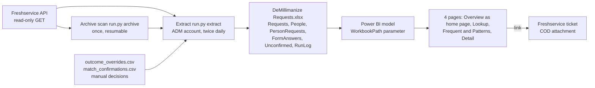

# Project Overview

> **This file must be updated with every change.** See [AGENTS.md](AGENTS.md#8-required-on-every-change).

**Last updated:** 2026-11-24

## Current status

**Phase:** Building, stage 2. Michael's Power BI specification has been merged into the project. The full extract (Freshservice → Excel workbook in Michael's schema), a fake-data workbook, the Power BI model script, the theme and the build guide are written.

- **Tested:** 80 unit tests pass, including a full extract run and an archive scan against a fake Freshservice client. The live extract ran on 2026-11-25 with Michael's key: 205 requests created from 2023-07-01 on (161 from archived tickets, 44 current), 3 of them confirmed by Michael and none left waiting. The archive scan finished all 1,141 pages on 2026-11-24. All Certificates of Destruction on current and archived tickets were read where the layout was recognized (177 of 179). The four report pages opened and refreshed in Power BI Desktop with the live workbook.
- **Not tested:** publishing and sharing the report, scheduled runs, and the ADM account run. Archived tickets are searched by **subject only** (Michael chose this on 2026-11-24), so an archived request whose wording is only in the body is missed.

## Requirements summary

| # | Requirement | Priority | Status |
|---|---|---|---|
| R1 | Search by employee name (as requester **and** as recipient) | Must | Done: Request Lookup page with a type-to-search name box |
| R2 | Show request date and outcome (Approved / Denied / Pending / Needs Review) per request | Must | Done |
| R3 | Pull De-Millimanize tickets from Freshservice (read-only), both form and legacy | Must | Running live. Archived tickets come from `python run.py archive` |
| R4 | Total count of completed De-Millimanize tickets | Should | Done (Overview) |
| R5 | Flag repeat requests within 120 days (Frequent) | Should | Done |
| R6 | Requests by practice (the practice on the receiver's own Freshservice account) | Nice | Done (Overview) |
| R7 | Requests by device type | Nice | In the data; the Overview shows models instead |
| R8 | Link to the ticket's Certificate of Destruction | Nice | Ticket URL and certificate flags done |
| R9 | Abuse patterns: holiday season, devices for others, duplicate serials (from Michael's spec) | Should | Month-by-year heatmap and gap chart on the Patterns page. Devices-for-others and duplicate-serial tables were removed from the report on 2026-11-24 (Michael); the columns and measures remain |
| R10 | Data quality and refresh health: Needs Review worklists and RunLog (from Michael's spec) | Should | Done (Ticket Detail and Data Quality page) |

## Architecture

**Chosen by Kevin (2026-11-19), merged with Michael's specification:** an extract script writes an Excel workbook, and Power BI only reads that workbook.

Why there's an extract step instead of Power BI calling the API:

- **API key:** The key is personal and stored in a Windows environment variable. Power BI can't read environment variables, but a script can. Viewers never need a key.
- **Legacy tickets:** Finding them takes fuzzy matching and a review list. That's much easier to write and test in a script than in Power Query.
- **Business rules:** Outcome, Frequent and technician handling are computed once in tested Python. Power BI surfaces them and never recomputes them.

Trade-off: someone has to run the script, or schedule it on a machine, to refresh the data.

**Runtime:** Python 3.13, installed machine-wide at `C:\Program Files\Python313` (on the machine PATH, so the ADM account can use it). The required dependency is **openpyxl 3.1.5**, pinned in `requirements.txt`. It's needed to write Excel tables and was already installed machine-wide (checked 2026-11-19). **pypdf 7.1.1** (pinned) is optional: it reads the text of the Certificate of Destruction PDFs. Without it the extract still runs and the `COD …` columns stay blank. It's installed for Michael's account (`pip install --user pypdf==7.1.1`). The ADM account needs its own install. `uv` isn't used because it's installed per-user and the ADM account can't reach it.

### Workbook (data contract with Power BI)

- **File:** `DeMillimanize Requests.xlsx`. It's in `data\` for now (git-ignored). The target is the CMH IT SharePoint library (folder still to be confirmed).
- **Tables:** `Requests`, `People`, `PersonRequests`, `FormAnswers`, `Unconfirmed`, `RunLog`. Column names follow Michael's specification exactly, and the list lives in `extract/tables.py`.
- **`Unconfirmed`** (added 2026-11-24) holds tickets the wording rules aren't sure about: Ticket ID, Ticket URL, Created Date, Requester Name, Subject, Confidence, Evidence, Excerpt, Resolution Note, Archived. These tickets are **not** in `Requests` and aren't counted until a person answers yes or no in `data\match_confirmations.csv`.
- **Additions to Michael's columns:**
  - `Requests`: `Requester Is Technician`, `Recipient Is Technician`
  - `Requests`: `Model`, `Model Line`, `Model Source`, `Model Group` (tidied model names, filled from the PC name and machine type when the form has none; `Model Group` names a model line only when it has 10 or more requests, joins a rarer one to its family such as "Other ThinkPad", and shows "Not identified" when no model can be found, so the pie chart stays readable)
  - `Requests`: `Match Confidence` (High or Confirmed) and `Archived` (Yes or No). `Match Needs Review` is now always No, because unsure tickets are held in `Unconfirmed`; the column stays for the data contract
  - `Requests`: `Recipient Source` says where the recipient came from: Form, Requested for, Subject, Subject (name only), Resolution note, Resolution note (name only), or blank when the ticket doesn't say
  - `Requests`, from the Certificate of Destruction PDF (`extract/cod.py`): `COD Erase Date`, `COD Erase Method`, `COD Erase Result`, `COD Erase Errors`, `COD Motherboard`, `COD Processor`, `COD Memory`, `COD Drive Size`, `COD OS`, `COD BIOS`, `COD Device Serial`, `COD Serial Matches Ticket`
  - `People`: `Technician`
  - `RunLog`: `Finished (Local)`, used for the "Last refreshed" label
- **State:** `data\state\` holds the cached tickets and the run history used for incremental runs, plus the archive scan's progress (`archive_scan.json`) and the archived tickets it kept (`archive_tickets.json`).

### Power BI (`powerbi/`)

- **`DeMillimanize.model.tmdl`:** A model script pasted into Desktop's TMDL view. It contains the tables, Power Query, DimDate, GapBuckets, 40+ measures, 4 relationships and the RLS role. It's generated from the schema by `python run.py tmdl`.
- **`DeMillimanize.theme.json`:** Freshservice-style theme (navy `#12344D`, teal `#00C1A0`, outcome colors).
- **`GUIDE.md`:** Setup, a page-by-page build guide, publish/refresh/share steps, the validation checklist and assumptions.
- **Relationships:**
  - People → PersonRequests (single direction)
  - PersonRequests ↔ Requests (both directions, so a selected person filters Requests)
  - DimDate → Requests on Created Date
  - Requests → FormAnswers
- **Fake data:** `sample_data/make_mock_workbook.py` creates a **fake** workbook so the report can be built now.

### Refreshing the data (decided 2026-11-19)

- **Scheduled:** `tools\schedule-extract.cmd` creates two Task Scheduler tasks (05:30 and 12:30) that run the extract as the ADM account. Written but not run yet.
- **Power BI Service:** Schedule the refresh at 06:00 and 13:00, after the extract.
- **Power BI Desktop Refresh button:** It reloads the latest workbook. Power BI stays on the standard account.
- **"Run extract now":** `tools\run-extract.cmd` runs the extract as the ADM account on demand, before clicking Refresh.
- **Run modes:** The first run is **Full** (tickets updated since 2015-01-01). Later runs are **Incremental** (since the last success, minus 2 days). `run.py extract --full` forces a full run. A failed run keeps the previous data and logs "Failed" in RunLog.

Power BI reports show the data from the **last refresh**. They don't fetch new data just because someone opens the report.

**API key and the ADM account:** The key is in the `FRESHSERVICE_API_KEY` **user** environment variable of the **Kevin.ConcepcionADM** account. Scripts that call the API must run as that account. Power BI does **not** need to.

**Project folder and the ADM account:** `O:\` is Kevin's home share (`\\milw-isilon-prod-smb.milliman.com\milwh-users$\kevin.concepcion`). Drive letters are per-user, so the ADM account has to use the **UNC path**. We still need to confirm the ADM account can read and write there; the probe will show this.

**Freshservice URL:** The API host is **`https://milliman-helpdesk.freshservice.com`**, confirmed from SPARK's source (`O:\Notes\SPARK Freshservice API Connection.md`). The first probe run used `https://hd.milliman.com`, which is the **portal** address, and got HTTP 404. That was the cause of the failure. The host can be overridden with `FRESHSERVICE_BASE_URL`. If the server redirects, the client stops and reports the target host, because following a redirect would send the API key to another server.

**First probe run (2026-11-19):** The launcher worked and the ADM account read `FRESHSERVICE_API_KEY`. The UNC path worked. The call failed with 404 because of the wrong host (see above).

**Second probe run (2026-11-20), against `milliman-helpdesk.freshservice.com`:** This run **worked**. Results (field names and types only):

- **Reads that succeeded:**
  - The key belongs to an agent.
  - 81,015 tickets created since 2015.
  - Ticket 653455, with its requested items, approvals, conversations and the normalized bundle.
- **Status choices:** 2 Open, 3 Pending, 4 Resolved, 5 **Closed**, 6 Waiting on Approval, 7 Waiting on GCS, 8 Approved, 9 Waiting on Child Ticket, 10 Waiting on Requester Response.
- **`GET /agents` returns HTTP 403** with this key. Technicians are therefore also taken from **ticket assignees** (`responder_id`); the procedure has the technician assign the form ticket to themselves.
- **The ticket list includes `description_text`**, so older tickets that only mention De-Millimanize in the description are found.
- **"Computer provided to" is a user ID** (`computer_provided_to`, no numeric suffix on this item). It resolves to a name and email **only when it matches the ticket's requester or requested-for**. Any other ID can't be looked up while person reads return 403, so it shows as "Unknown user (ID n)".
- **Certificate PDF:** it's attached to the **requested item**, not the ticket. The extract now reads both.
- **Ticket-level approval:** the ticket has `approval_status_name`. It's used when the approvals list is empty.
- **Person and department reads are denied (HTTP 403):** `/requesters/{id}`, `/agents/{id}` and `/departments/{id}` all return 403 with this key (probe lookups step, 2026-11-20). Names and emails still come from the ticket itself (`include=requester,requested_for`). The extract stops calling a lookup after its first 403, so denied calls don't use up the rate limit.

**Lessons from the Spark project** (from SPARK's source, summarized in `O:\Notes\SPARK Freshservice API Connection.md`, branch `SPARK-PCR-KEVIN`):

- SPARK calls these GET paths: `/agents/me`, `/tickets/{id}`, `/tickets/{id}/requested_items` (form answers are under `custom_fields`), `/tickets/{id}/conversations?per_page=100&page=N`, `/requesters/{id}` and `/departments/{id}`. **`/requesters/{id}` and `/departments/{id}` return 403 with this key, in SPARK too.** SPARK's latest commit explains these 403s to agents as missing permission to look up the employee's profile.
- **How SPARK works around it:**
  - A **local department table** (`Services/DriveMappings.cs`, 18 department IDs). It calls `/departments/{id}` only for IDs that aren't in the table.
  - **Practice from Active Directory** (`Services/AdUserPracticeLookupService.cs`): find the user by email or name, then take the practice OU code (for example `OU=CMH` → `CMH`) from their distinguished name. This project copied it on 2026-11-20 and **stopped using it on 2026-11-25**, when Michael's key turned out to read Freshservice person records (see Practice below).
- **Status numbers SPARK uses:** 2 Open, 3 Pending, 4 Resolved, 6 Waiting on Customer, and 8 In Progress. The number for Closed isn't in SPARK, so the probe's status list will confirm it.
- SPARK's queries are limited to one agent and read only the first page. The dashboard needs all agents plus paging.
- Spark's API key could **submit** service requests but **couldn't read catalog definitions**. Our key may have similar read limits.
- Service-request custom field names get item-specific suffixes from Freshservice (for example `_252801`).

### Freshservice API facts (from official docs, api.freshservice.com, 2026-11-19)

- Authentication: HTTP Basic, with the API key as the username and `X` as the password.
- `GET /api/v2/tickets`: Returns only the **last 30 days** by default, so older tickets need `updated_since`. It can filter with `type=Service Request`. Up to `per_page=100` results per page, with the next page given in the `Link` header. Embedding extra data with `include` costs 2 extra API credits per resource.
- The list endpoint's documented filters are `new_and_my_open`, `watching`, `spam`, and `deleted`. **Archived tickets (tested live, 2026-11-24):**
  - `GET /api/v2/tickets?filter=archived` lists them. This filter isn't in the official docs. It accepts `order_type=asc`, `per_page=100` and `page=N`.
  - There were **114,047 archived tickets (1,141 pages)**, created from August 2019 to November 2025. The newest was about a year old, which suggests tickets are archived after roughly a year (not confirmed).
  - Each page takes about **12 seconds**. Four requests at once take the same time, so the scan runs 4 at a time (about 18 requests a minute, against a limit of 140).
  - The archived list has **no description**, only the subject and basic fields. A ticket's description, notes and attachments are readable one ticket at a time with `GET /api/v2/tickets/[id]`, which returns `archived: true`.
  - `GET /api/v2/tickets/archived/[id]` returns 404, and `/tickets/filter` only returns tickets that aren't archived.
- `GET /api/v2/tickets/filter?query=...` can't search the subject. It returns a `total` count and 30 results per page.
- `GET /api/v2/tickets/[id]?include=conversations` returns up to 10 conversations. `include=ticket_attachments` returns attachment details.
- HTTP 429 means the rate limit was exceeded. The client waits for `Retry-After` and then retries.
- **Not yet confirmed (the probe checks these):** the exact paths for requested items (`/tickets/[id]/requested_items`), ticket fields (`/ticket_form_fields`), and agents (`/agents`).

- **Data source:** Freshservice API, read-only. Access was first set up through Spark.
- **Visualization:** Power BI. Power BI Desktop is installed on the developer machine (checked 2026-11-19).
- **Source format:** Power BI Project (`.pbip`) instead of `.pbix`, so the report is stored as text files that git can track and compare.
- **Authentication:** Microsoft sign-in through the Power BI Service. Only people the report is shared with can open it.
- **Certificates of Destruction:** The dashboard links to the Freshservice ticket, and the COD is opened there. The dashboard does not copy or store the PDFs.

## De-Millimanize policy (summary)

This comes from the internal IT policy note, last updated 2021.

- **Who can ask:** An employee whose old laptop is being replaced, or who is retiring or leaving Milliman. The program is **not advertised**.
- If the laptop is past warranty and going to a Milliman employee, the user needs **supervisor approval**.
- Requests from retiring EPs (SEAT) are approved.
- The laptop is fully wiped and has only the Windows operating system afterward.
- *Older guidance:* The employee may need to pay shipping to receive the laptop.

This is why Shannon wants to see repeat requests. Frequent asks from the same person go against the purpose of the program.

## Freshservice data (from ticket screenshots)

There are **two kinds** of De-Millimanize tickets.

### 1. Form-based tickets (current process)

| Item | What we saw |
|---|---|
| Ticket type | Service Request (`SR-` prefix) |
| Subject pattern | `Request for <Name> : "De-Millimanize" Device with Milliman Data` |
| Requested item | `"De-Millimanize" Device with Milliman Data` (service catalog item) |
| Form fields | PC Serial Number, PC Make and Model, Most recent PC Name, **Computer provided to** |
| COD | PDF attached to the ticket, named `Certificate-<OldPCName>-<ComputerID>-<SerialNumber>-<Status>-<YYYY-MM-DD>-<HH-mm-ss>.pdf` |
| Group / Department | CMH Health IT Support / CMH Health |
| Category | The procedure says *Ticket Management > User resolved issue*, but at least one ticket uses *Hardware > Laptop*. **Category is not reliable for filtering.** |
| Resolution notes | `Demillimanized laptop for <Name>` (by procedure) |

**Who received the device:** Use the **Computer provided to** field. The ticket's requester can be the IT technician who filed the form for someone else.

**Older forms have no recipient field (found 2026-11-24).** The "Computer provided to" field was first filled in on 2025-12-11, so the 159 forms before that have it empty. The extract reads who got the device in this order (`Recipient Source` shows which rule applied):

1. **Form:** the form's "Computer provided to" value. It wins over the subject when the two disagree (9 live tickets), because it is filled in on purpose and the subject defaults to whoever submitted the form.
2. **Requested for:** the "requested for" person, when they differ from the requester.
3. **Subject** (added 2026-11-25, Michael): the name in the subject, `Request for <Name> : "De-Millimanize" Device with Milliman Data`, **is the recipient** (`extract/classify.py` `recipient_from_subject`). If the name is the requester or the requested-for person, that ticket record is used. Otherwise Active Directory is asked by full name, and a name nobody matches is shown as written and linked to nobody (**Subject (name only)**). When a technician files the form without changing the name, the technician is the recipient, so the ticket is **technician-listed (possible charity)** and uses the technician's practice (Michael's choice, 2026-11-25).
4. **Resolution note:** a name after "for" or "to" in the technician's note, for example "De-Millimanized for Jane Example" (`recipient_from_note`). Donation and charity notes are skipped. It **replaces a technician named in the subject** when Active Directory finds exactly one employee with that full name (Resolution note), because the technician's name is only the form default. A bare name (a charity, a first name) never replaces it, and is only shown when the subject names nobody (Resolution note (name only)).
5. Nothing: the recipient is blank.

After the subject rule, the live data has 35 requests from the form, 11 from requested-for, 145 from the subject, 2 from a note matched to one employee, 2 notes shown as written, and 12 with no recipient name (mostly free-text tickets with no form). 160 requests have a technician as recipient, which is why name search and the Frequent flag only cover the ones with an employee recipient.

**Technician-listed tickets:** For charity devices, the procedure has the technician enter **their own name** in "Computer provided to." If that name matches a Freshservice **agent**, the ticket is placed in a separate **Technician-listed (possible charity)** category. It doesn't count toward that person's own request history. (Confirmed by Kevin, 2026-11-19.)

**Practice (changed 2026-11-25, Michael):** the practice is the **department on the receiver's own Freshservice account**. The form doesn't record it, but the account does. Kevin's key got HTTP 403 on person and department reads, which is why Active Directory was used before; **Michael's key can read them**, so Active Directory is no longer used (its code was removed from `extract/practices.py` and is in the git history).

- The extract reads `GET /requesters/{id}` (or `/agents/{id}` for a technician). The record has `department_ids` and `department_names`. A department shows with the short name in SPARK's table of 18 IDs ("CMH Health" is `CMH`, "EB Consulting" is `EBC`); any other department keeps the name Freshservice has.
- `People[Department]` = that person's Freshservice department, blank when the account has none.
- `Requests[Department]` = the practice of the person **receiving** the device. A technician-listed ticket (a technician named as recipient) uses the **technician's** own department, usually CMH (Michael's choice, 2026-11-25). The ticket's own department is **not** used as a fallback, because it is the filer's. "Not recorded" appears when the receiver has no department or no receiver is known.
- **Names with no person on the ticket** (a subject name that isn't the requester, or a name in the resolution note) are searched in Freshservice by first and last name (`GET /requesters?query="first_name:'A' AND last_name:'B'"`, then `/agents`). Exactly one match counts as that person. Nobody, or more than one (a shared name), counts as nobody. Answers are cached in `data\state\people.json`, and a name nobody matched is tried again next run.
- **A key that can't read requester records** gives no practice at all. If the scheduled extract runs under another account's key, check that key first.

### 2. Legacy tickets (created before the form existed)

- These have no requested item and no form fields. They are free-text requests, for example "Demillimanize recent old laptop."
- The name has to come from the **requester**.
- Spelling varies ("Demillimanize", "De-Millimanize", "demillimanized"). **No single text rule finds all of them** (confirmed by Kevin, 2026-11-19). The plan is a matching method that flags *candidate* legacy tickets, shown as "Legacy: matched by keywords" so a person can review them. The method will be tested against known examples before anyone relies on it.
- Some have an **approval** (approver plus Approved status) attached.
- At least some are **Archived** in Freshservice. The API does return them (confirmed 2026-11-24), through a separate, slow list. `python run.py archive` scans that list once and keeps the possible requests. Because the archived list has no description, **an archived request is only found when its subject has the wording**. One whose subject is plain ("Laptop") and whose wording is only in the description is missed.

### Business rules (implemented in `extract/classify.py` and `extract/tables.py`)

**Matching and confidence (rewritten 2026-11-24, Michael):**

A ticket is looked at when its subject or description has a De-Millimanize spelling variant, or names a device together with keep or personal-use wording ("keep company laptop", "laptop for personal use", "for personal use"). "Keep my laptop from sleeping" and similar don't count.

| Match Source | Meaning |
|---|---|
| Form | The requested item is the De-Millimanize catalog item |
| Phrase | Wording only: a spelling variant of De-Millimanize, or keep / personal-use wording |
| Both | Both of the above |

Confidence decides whether the ticket is counted. Points are added up for each piece of wording:

| Where the wording is | De-Millimanize word | Keep / personal-use phrase |
|---|---|---|
| Subject | 3 | 3 |
| Resolution note | 3 | not used |
| Description | 2 | 2, or 1 when "for personal use" isn't near a device word |

| Confidence | Rule | What happens |
|---|---|---|
| High | The form item. Or 4 points or more **and** the request itself is clear (wording in the subject, or a keep / personal-use phrase) | Counted in `Requests` |
| Medium | 2 or 3 points, or 4 or more where the wording is only a mention in the description or resolution note | Held in `Unconfirmed` |
| Low | 1 point | Held in `Unconfirmed` |
| Confirmed | A person answered Yes in `data\match_confirmations.csv` | Counted in `Requests` |

- **Confirming once:** `data\match_confirmations.csv` has `Ticket ID, Is De-Millimanize (Yes/No), Reviewed By, Reviewed On, Note`. Yes moves the ticket into `Requests`. No removes it for good, even if the rules were sure. Each ticket only needs an answer once.
- **Why hold them back:** the first live run counted a "Remote computer restart" ticket as a request because it mentioned a de-millimanized laptop. Unsure tickets no longer reach the numbers on their own.

**Outcome** (Approved / Denied / Pending / Needs Review). The first rule that applies wins:

| Order | Source data | Outcome | Outcome Source |
|---|---|---|---|
| 1 | A row in `data\outcome_overrides.csv` | As written there | Manual Override |
| 2 | Latest approver decision: approved or rejected | Approved / Denied | Approval |
| 3 | Status Closed, no denial wording in notes or resolution note | **Approved**. Kevin confirmed Closed = given | Closed ticket text |
| 4 | Status Closed **with** denial wording | **Needs Review**. Never an automatic Denied; a person confirms it with an override | Closed ticket text |
| 5 | Any other known status | Pending | Status: <name> |
| 6 | Status can't be read | Needs Review | Unknown status |

**Frequent (changed 2026-11-25, Michael):** **anyone named as "Computer provided to" on tickets less than 120 days apart.** Michael's example: Andrew Schmitz was the recipient on July 13 and August 10, 2026, 28 days apart, so he belongs on the list.

- **Who counts:** a person is Frequent when two tickets name them as the recipient (whatever the source: the form field, requested-for, the subject, or a matched closing note) and the gap between two of those tickets is 120 days or less. `People[Shortest Gap (Days)]` is the smallest such gap and `People[Last Received]` is the date of their latest recipient ticket.
- **Technicians are included** (Michael: "anybody who is the computer provided to"). Andrew Schmitz is a Freshservice agent, so the earlier rule, which excluded technicians, had hidden him. The list has a **Technician** column so a reader can tell. Many technicians are named on charity devices (one has 38 tickets), so most of the list is technicians.
- **Only recipient tickets count.** Asking for someone else's device (`Requests Made For Others`), or a free-text request with no recipient named, does not.
- **Several devices on one day count** as separate tickets, so one person given 3 computers on the same day (gap 0) is on the list. An earlier version (a few hours before) treated tickets within 14 days as one request; Michael's rule replaced it.
- The per-ticket columns (`Recipient Request #`, `Frequent (Recipient)`, `Days Since Previous (Recipient)`) follow the same rule. The requester versions are unchanged, and technicians are still not counted as requesters.
- **Result on the live data:** 13 people, 11 of them technicians and 2 employees. Gaps: 0 days for 9 people, then 7, 11, 28 (Andrew Schmitz) and 45.
- A denied request still counts, since the rule is about who a computer was provided to.

**Other rules:**

- **Holiday Season:** Nov 15 through Jan 5.
- **Same Serial Seen Before:** The serial appeared on an earlier ticket.
- **Certificate details (`COD …` columns):** Read from the text of the ticket's `Certificate-*.pdf` (an Active@ KillDisk erase certificate). Each PDF is downloaded once from the matching ticket's attachment link (GET only, no API key sent, `*.freshservice.com` only), and only the parsed fields are cached in `data\state\cod.json`. The PDF isn't stored. `COD Motherboard` is the raw "Motherboard" line (for Lenovo it holds the machine type, for example `LENOVO 21ALS1LC00`; other makes may show a board part number, so it isn't a model name). **Warranty and purchase dates are not on the certificate.** `COD Serial Matches Ticket` compares the BIOS serial on the certificate with the serial typed on the form (ignoring case and spaces), and is blank when either is missing.
- **Certificate Missing:** A closed form ticket with no `Certificate-*.pdf` attachment.
- **Device Type:** From model families. ThinkPad, Latitude, EliteBook and similar = Laptop. ThinkCentre, OptiPlex and similar = Desktop. Otherwise Freshservice sub-category Laptop or Desktop, otherwise Unknown.
- **Model (rewritten 2026-11-25, Michael):** `Model Source` says where it came from, in this order:
  1. **Ticket:** the make and model typed on the form, tidied (`lenovo t14s` becomes `ThinkPad T14s`). A value that is really a serial number (`MJ0E843G`), a machine-type code (`20NY`, `S09B00`) or filler (`Test`) is not a model name and is skipped.
  2. **PC name:** the old PC name spells out the model. `MILWI-T15-JF` is a ThinkPad T15, `CMH-P14S-JF` a P14s, `MilwH-M920x-AB` a ThinkCentre M920x. It is read from the form's "Most recent PC name" and from the certificate's file name (`Certificate-<PC name>-<serial>-<disk>-Success-<date>.pdf`). Only whole segments of the name that look like a model count (T/X/P/E/L series, ThinkCentre M, Surface Pro, Dell 5xxx/7xxx), so practice codes and initials don't match by accident. The text printed inside the certificate has **no model name**, only a machine type, which is why the PC name is used.
  3. **Certificate (same machine type):** other tickets with the same four-character Lenovo machine type (`20S7`) all have the same model line, so this one does too. Two different models for one machine type means no answer, not a guess.
  4. **Machine type only** (`Lenovo machine type 20CD`) or **Not recorded**.
  
  Result on the live data (205 requests): 161 from the ticket, 25 from the PC name, 6 from a matching machine type, 1 machine type only and 12 not recorded, so **13 are not identified, down from 30**. `Model Group` (the pie) names a model line separately when it has 10 or more requests (13 slices in all; the odd Apple Mac and the one unusual model share "Other models").
- **Profile counts:** People[Approved / Denied / Pending / Needs Review] cover only requests where the person is the one receiving the device.

**Denials:** Kevin doesn't know of any denied request. A denied request probably never gets a form ticket, and any denial would most likely be recorded only in a ticket's notes. So the dashboard flags possible denials as Needs Review, and a person confirms them through the override file.

## Key decisions

| Date | Decision | Reason |
|---|---|---|
| 2026-11-19 | The dashboard is read-only against Freshservice | Reviewing ticket history doesn't require writing data, and read-only access lowers risk |
| 2026-11-19 | Use **Power BI** (not Grafana or a custom web app) | Already installed and part of Microsoft 365, so sign-in and sharing are built in. No server to host. Slicers handle name search. Grafana is designed for time-series monitoring and would need a server. |
| 2026-11-19 | Link to the COD on the Freshservice ticket instead of downloading it | CODs are already stored on the ticket. This avoids copying employee PDFs, and Freshservice attachment links expire. |
| 2026-11-19 | Identify the recipient with **Computer provided to** (form tickets) or the requester (legacy tickets) | The ticket requester is often the IT technician, not the employee who got the device |
| 2026-11-19 | COD link approach confirmed | Anyone with access to the ticket can view and download the COD, and Shannon has Freshservice access |
| 2026-11-19 | Technician-listed tickets get their own category | Charity devices are recorded under the technician's name and shouldn't count as that person's requests |
| 2026-11-19 | Only Closed counts as completed. Other statuses are shown as they are. | Confirmed by Kevin. Avoids guessing what other statuses mean. |
| 2026-11-19 | Denials are flagged for review, never auto-labeled | Denials are only recorded in free-text private notes, if at all |
| 2026-11-19 | Scheduled extract runs twice daily. Desktop Refresh reloads the file, and a separate "Run extract now" shortcut runs as ADM. | Chosen by Kevin. Keeps Power BI off the admin account. |
| 2026-11-19 | Extract uses the Python standard library only | Nothing to install, it works for the ADM account, and it keeps dependencies to a minimum (AGENTS.md rule 5.3) |
| 2026-11-19 | The API client is GET-only, https-only, refuses redirects, and only sends the key to the configured host | Enforces AGENTS.md section 2 and protects the API key |
| 2026-11-19 | Merged Michael's Power BI specification: Excel workbook contract, 5 tables, 4 pages, measures, theme, RLS | Michael's spec covers the report, and our extract is the "daily job" it assumed |
| 2026-11-19 | Outcome vocabulary is Approved / Denied / Pending / Needs Review, with a manual override file | Michael's spec. It keeps our rule that denial wording means Needs Review, not an automatic Denied |
| 2026-11-19 | Frequent window is 120 days (was "about 3 months") | Michael's spec |
| 2026-11-19 | Practice is the Freshservice department, not AD | Michael's schema has Department, SPARK already uses it, and it needs no extra access. **Superseded 2026-11-20, see below.** |
| 2026-11-19 | Use openpyxl (pinned 3.1.5) instead of the standard library only | Excel named tables are needed for Power BI. It was already installed machine-wide |
| 2026-11-19 | Model delivered as a TMDL script plus a build guide, not a full `.pbip` | Michael's spec allows this fallback. A hand-written report file can't be tested here and could fail to open |
| 2026-11-25 | Practice comes from the receiver's own **Freshservice account**, not Active Directory (Michael's decision). This reverses the entry just above | Michael's key can read requester, agent and department records, so the practice Freshservice shows is available directly. Active Directory is no longer called |
| 2026-11-20 | Practice comes from **Active Directory by email** (SPARK's method), with SPARK's local department table as the fallback | Freshservice `/requesters/{id}` and `/departments/{id}` return 403 with this key. The alternative is a key permission change (open question 2) |
| 2026-11-20 | Stop calling a Freshservice lookup after its first 403 in a run | A 403 won't change mid-run, and repeated calls waste the rate limit |
| 2026-11-20 | Clear only Python 3.13's `VERIFY_X509_STRICT` flag for Freshservice TLS (approved by Kevin) | Windows trusts two Zscaler roots with the same name. The older one (expires 2042, thumbprint `D72F47D8…`) lacks a critical Basic Constraints flag, so 3.13's strict check failed for the ADM account. Chain and hostname are still verified, as in Python 3.12 |
| 2026-11-24 | Get model and device details from the Certificate of Destruction PDF, not Lansweeper (Michael's decision) | It uses the same Freshservice key, needs no database access or admin changes, and the certificate is already the record for each ticket. It has no warranty data. |
| 2026-11-24 | Tickets the wording rules aren't sure about are held out of the counts until a person confirms them once (Michael's decision) | A wrong number in front of the program owner costs more than a short confirmation list. The first live run had counted a ticket that only mentioned a de-millimanized laptop |
| 2026-11-24 | Archived tickets are read by a separate, resumable scan, 4 requests at a time | The archived list is slow (about 12 seconds a page, 1,141 pages) and archived tickets don't change, so it only needs doing once. 4 at a time is about 18 requests a minute, far below the 140 limit |
| 2026-11-24 | A new archive scan starts at tickets created on or after 2024-01-01 (Michael's decision) | It cuts a rescan from about 1,140 pages to about 430. Requests already found from before 2024 are kept. `python run.py archive --all` scans everything |
| 2026-11-24 | Overview is the home page and shows less (Michael's decision) | The first version had 23 visuals and was hard to read. The devices-for-others and same-serial tables were removed from the report |
| 2026-11-25 | The frequent requesters table is back on the Overview (Michael's decision) | It's the one repeat-request view Michael wants on the front page. The Overview now has 16 visuals |
| 2026-11-24 | Archived tickets are searched by subject only (Michael's decision) | Reading every archived body would take about 4.5 hours (42,000 reads since 2024). Reading bodies only where the subject names a device would take about 30 minutes, but Michael chose to leave it as subject only |
| 2026-11-24 | Practice shows "Not recorded" when a technician filed the form and no recipient is known, and a name in the resolution note is used as the recipient (Michael's decisions) | The technician's practice (CMH on 155 archived tickets) isn't the recipient's. Only a name Active Directory matches to exactly one employee is linked to a person. **Superseded 2026-11-25 for practice and the subject, see below.** |
| 2026-11-25 | Tickets created before 2023-07-01 are left out of the workbook (Michael's decision) | Michael said earlier data isn't relevant. It removed 2 requests (one from 2021) and starts the Overview's date filter and the heatmap in 2023. Set with `DEDASH_DATA_START` |
| 2026-11-25 | The name in a form ticket's subject ("Request for <Name> :") is the recipient, even when it is a technician; technician-listed tickets use the technician's practice (Michael's decisions) | Michael supplied the rule. 140 of the 144 archived tickets with no recipient field name a technician, which matches the technician-listed (possible charity) rule. The form field still wins when it disagrees (Michael said either was fine) |
| 2026-11-24 | Overview is the home page and shows less: 4 filters, 5 numbers, 2 charts, a practice bar and the latest requests (Michael's decision) | The first version had 23 visuals and was hard to read. Devices-for-others and same-serial tables were removed from the report |

## Open questions

1. **Power BI licensing:** This isn't a blocker for building, because Power BI Desktop is free. It needs to be revisited **before publishing**.
2. **ADM scheduled task:** Is IT policy OK with a scheduled task running under an ADM account? Long term, should refreshes use a dedicated service key? A key whose agent role **can view requesters and departments** would also let practice come from Freshservice directly, and would resolve "Computer provided to" IDs that don't match the requester or requested-for. Ask the Freshservice admin.
3. **Archived tickets:** **Answered (2026-11-24).** The API returns them through `filter=archived` (see the API facts). Still open: archived requests whose wording is only in the description can't be found without reading every archived ticket one at a time (114,000 calls).
4. **SharePoint location:** Which CMH IT library and folder will hold the workbook, and how does the extract machine write there (OneDrive sync with `DEDASH_DATA_DIR`, or an upload step)? A local or UNC path in the Power BI Service needs a gateway.
5. **Data file location (current):** It's in `data\` inside the project folder (git-ignored).
6. **ADM access to the project folder:** **Confirmed (2026-11-20).** The ADM account saved `data\probe_report.json`.
7. **"Computer provided to" format:** **Answered (2026-11-20).** It's a Freshservice user ID.
8. **Ticket links for Shannon:** They currently use `milliman-helpdesk.freshservice.com/a/tickets/<id>`. Should they use `hd.milliman.com` instead? Change this with `DEDASH_TICKET_URL_BASE`.
9. **Approvals API:** **Partly answered (2026-11-20).** `/tickets/{id}/approvals` works but was empty for 653455. The shape of a real approval is still unseen. Probe a ticket that had an approval (for example legacy ticket 495852).
10. **Ticket list includes `description_text`:** **Answered (2026-11-20).** Yes.
11. **Person and department lookups:** **Answered (2026-11-20).** They return HTTP 403; the key's agent role can't read requester, agent or department records. Practice now comes from AD (see Practice above).
12. **Outdated Zscaler root:** Should IT remove the older Zscaler root (expires 2042, thumbprint `D72F47D8…`) from the Windows trusted roots? Then the strict-check exception could be removed.

## Change log

| Date | Author | Change |
|---|---|---|
| 2026-11-19 | Kevin Concepcion (with AI agent) | Created README.md, AGENTS.md, and OVERVIEW.md |
| 2026-11-19 | Kevin Concepcion (with AI agent) | Chose Power BI. Documented the Freshservice ticket structure (form and legacy), the draft status mapping, and the COD approach. Updated open questions. |
| 2026-11-19 | Kevin Concepcion (with AI agent) | Added the policy summary, recorded answers on denials, the technician/charity category, Closed status, the personal API key, COD access, legacy detection, and AD practice lookup. Proposed an extract-script architecture. Reset the open questions. |
| 2026-11-19 | Kevin Concepcion (with AI agent) | Restored AGENTS.md (accidentally emptied, never committed) with its original content. Documented refresh options, the API key's location under the ADM account, and the licensing note. |
| 2026-11-19 | Kevin Concepcion (with AI agent) | Stage 1: added `.gitignore`, `.env.example`, the read-only API client (`extract/freshservice.py`), the matching rules (`extract/classify.py`), the probe (`extract/probe.py` and `tools/probe.cmd`), and unit tests. **Tested:** 16 unit tests pass (fake data). The probe stops cleanly on the standard account with no key. **Not tested:** any live API call. |
| 2026-11-19 | Kevin Concepcion (with AI agent) | Fixed the probe launcher. "Run as different user" did nothing, because the ADM account has no `O:` drive. `probe.cmd` now finds the folder's UNC path (`run.py unc`) and uses `runas` to start the probe as the ADM account, which loads its profile so `FRESHSERVICE_API_KEY` is available. **Tested:** UNC lookup returns the correct path, and tests still pass. **Not tested:** the `runas` step, which needs the ADM password. |
| 2026-11-19 | Kevin Concepcion (with AI agent) | First live probe run: the launcher, the ADM key, and the UNC path all worked, but `hd.milliman.com` returned 404 for the API. Reviewed Spark's notes for Freshservice lessons (read-permission limits, field-name suffixes, Okta for practice). |
| 2026-11-19 | Kevin Concepcion (with AI agent) | Found the cause of the 404: wrong host. Switched the default API host to `milliman-helpdesk.freshservice.com`, as used by SPARK. Added an `agents/me` key check to the probe. **Tested:** the config resolves the new host, and 16 unit tests pass. **Not tested:** a live probe against the new host. |
| 2026-11-19 | Kevin Concepcion (with AI agent) | Merged Michael's Power BI prompt with the project. Added the full extract (`fetch.py`, `tables.py`, `workbook.py`, `run_extract.py`) writing his 5-table workbook, plus outcome rules, overrides, technician handling, incremental runs and RunLog. Added a fake-data workbook generator, the Power BI model script generator and TMDL, the theme, `powerbi/GUIDE.md`, `tools/run-extract.cmd`, `tools/schedule-extract.cmd` and `requirements.txt`. Updated the probe to show approvals, conversations and normalized-bundle shapes. **Tested:** 40 unit tests pass, including a fake-client end-to-end run with full, incremental and failure runs; Excel opens the mock workbook with 5 named tables; the theme JSON parses. **Not tested:** live API calls, the TMDL in Desktop, scheduled tasks, report pages. |
| 2026-11-20 | Kevin Concepcion (with AI agent) | Second probe run succeeded on `milliman-helpdesk.freshservice.com`; confirmed that `hd.milliman.com` is the portal address only. Fixed the extract to match the real data: recipient user IDs resolved from the ticket's requester or requested-for, certificate read from form-item attachments, ticket-level `approval_status_name` used as a fallback, technicians taken from ticket assignees because `/agents` is 403, and lookup failures reported in RunLog. Added a `lookups` step to the probe. Updated the offline test to the real response shapes. **Tested:** 40 unit tests pass. **Not tested:** a live extract run. |
| 2026-11-20 | Kevin Concepcion (with AI agent) | Handled the 403s on person and department reads the way SPARK does. Added `extract/practices.py`, containing SPARK's local department table and practice OU codes, plus a read-only AD lookup by email through PowerShell `DirectorySearcher`. `People[Department]` and `Requests[Department]` now use the recipient's (or requester's) AD practice. Lookups stop after their first 403. Added `tests/test_practices.py`, and the fake client now returns 403 for person and department reads like the real key. **Tested:** 44 unit tests pass; a live AD lookup resolved Kevin's own email to `CMH`, and a made-up email was reported as not found. **Not tested:** a live extract run. |
| 2026-11-20 | Kevin Concepcion (with AI agent) | Third probe run failed with `CERTIFICATE_VERIFY_FAILED: Basic Constraints of CA cert not marked critical` (ADM account). Cause: an older Zscaler root (2042) in the Windows store plus Python 3.13's strict X.509 check. With Kevin's approval, the client now clears only `VERIFY_X509_STRICT`, keeping chain and hostname verification. Recorded the exception in AGENTS.md 5.2. **Tested:** 45 unit tests pass, including a check that verification stays on; a verified handshake to Freshservice succeeded from the standard account. **Not tested:** a probe from the ADM account. |
| 2026-11-20 | Kevin Concepcion (with AI agent) | Fourth probe run (ADM account, ticket 653455) **succeeded** with the TLS fix. Every expected step passed: the recipient was resolved, the certificate was found on the form item, and the AD practice lookup found 1 of 1. Person and agent reads returned the expected 403s, the department came from the local table, and `/agents` is still 403. Ticket 495852 (archived/legacy) wasn't probed yet. |
| 2026-11-24 | Kevin Concepcion (with AI agent) | First Apply of the TMDL script in Power BI Desktop failed: `Unsupported Table name "Measures"`, because that name is reserved. Renamed the measure table to `_Measures` in `make_model_script.py` and regenerated the TMDL. **Not tested:** re-applying in Desktop. Any of the other errors in Desktop's Problems tab (6 were reported) that remain are still unknown. |
| 2026-11-24 | Kevin Concepcion (with AI agent) | Second Apply: all 6 problems were "Unexpected expression formatString / displayFolder" right after the first multi-line measure (`Avg Days to Decision`). TMDL view didn't accept the multi-line measure formulas, so `make_model_script.py` now writes every measure formula on one line (same DAX). Regenerated: 42 measures, all on one line. **Not tested:** re-applying in Desktop. |
| 2026-11-24 | Kevin Concepcion | The TMDL script **applied and refreshed successfully** in Power BI Desktop with the mock workbook. The model, measures and relationships load. Report pages are not built yet. |
| 2026-11-24 | Kevin Concepcion (with AI agent) | Added `powerbi/make_report_pages.py` (`python run.py pages`), which writes the 4 report pages from [powerbi/GUIDE.md](powerbi/GUIDE.md) into `DeMillimanize.Report/definition/pages` (PBIR format): Request Lookup (15 visuals), Overview (27), Frequent and Patterns (13), Ticket Detail and Data Quality (18). The earlier hand-made page was moved to `powerbi/page_backup_20261124`. Added 2 measures, `Frequent Color` and `Gap Bucket Color`, for conditional font colors. **Tested:** all 73 visual files are valid JSON with unique names; 45 unit tests pass. **Not tested:** opening the pages in Power BI Desktop. Left as manual steps: slicer search, sync slicers, clear-slicers button, drill-through, heatmap/data bars, per-outcome chart colors, holiday shading, top-10 department filter, turning off Auto date/time. |
| 2026-11-24 | Kevin Concepcion (with AI agent) | Readability fixes after Kevin opened the pages in Desktop. **Request history was empty** for Alex Tech: the table held the `Days Since Previous (Role)` measure, and Power BI hides rows where every measure is blank. The table now uses plain columns (`Days Since Previous (Recipient)`). **Frequent people was empty** once a name was chosen: the name slicer no longer filters it. **Timeline scatter error**: its X axis is now the earliest Created Date. **Cut-off text**: slicer headers hidden (the title names them) and slicers made taller; mock/refresh banners made taller; message cards have no box; the profile is now a table (Person, Email, Department, Technician, Frequent) plus a counts card with short labels; every table has word wrap, fixed column widths that fit the visual, no total row, and a link icon for Ticket URL; All requests and Refresh log show key columns only (every column stays in the workbook); line charts are straight, the monthly chart's axis is categorical, and the donut legend is at the bottom. **Tested:** 74 visual files are valid JSON with unique names. **Not tested:** how Desktop renders the changes. |
| 2026-11-24 | Michael Graeber (with AI agent) | Ran the **first live extract** with Michael's own API key (standard account, not ADM). The probe's connection, volume, statuses and agents steps passed. The full run succeeded: 26,019 tickets listed, 45 matched, 480 API calls. The workbook has Requests 45 rows (44 Approved, 1 Needs Review), People 37, PersonRequests 65, FormAnswers 149 and RunLog 1. It's in `data\` (git-ignored). RunLog notes that archived tickets may not be returned by the ticket list API (unconfirmed). **Not tested:** the report against the live workbook, the scheduled tasks, the ADM account run, and whether older archived tickets are missing. The `WorkbookPath` parameter in `DeMillimanize.SemanticModel/definition/expressions.tmdl` was then changed from the mock workbook to the live one on Michael's machine (`...\Test Repo\data\DeMillimanize Requests.xlsx`); other machines need to change it to their own path. |
| 2026-11-24 | Michael Graeber (with AI agent) | Read the **Certificate of Destruction PDFs** for device details instead of connecting to Lansweeper. New `extract/cod.py` (text parser), `FreshserviceClient.download` (GET of the ticket's pre-signed attachment link, `*.freshservice.com` only, no key sent, 5 MB cap), `Fetcher.certificate_details` (downloads once, cache in `data\state\cod.json`), 12 new `COD …` columns on `Requests`, a "Certificate Details" folder in the model script, and the optional pinned dependency pypdf 7.1.1. A cache from before this change triggers one automatic full run. Regenerated `powerbi/DeMillimanize.model.tmdl`. **Tested:** 53 unit tests pass. A live full run read all 35 certificates (35 Erased, 35 No Errors; 32 serials match the ticket and 3 don't). The first layout missed 15 certificates because some letter-space their headings ("R e s ult s") and write "Computer:". That's handled and covered by a test. **Not tested:** the new columns in Power BI Desktop (the model script needs to be re-applied), and the ADM account (needs its own pypdf install). Warranty is not on the certificate. |
| 2026-11-24 | Michael Graeber (with AI agent) | **Overview is now the home page.** `python run.py pages` regenerates it with 7 filters across the top (date, outcome, device type, model, practice, received by, requester), 10 headline cards (total, most recent, approved, needs review, frequent people, devices for others, holiday share, repeat serials, certificates missing, serial mismatches), a requests-by-month chart, a **pie of models**, an outcome donut, a practice bar, a frequent-requesters table and a most-recent-requests table. Page order is now Overview, Request Lookup, Frequent and Patterns, Ticket Detail. All 45 matched tickets are shown, with or without a certificate (10 have none). New `Model`, `Model Line` and `Model Source` columns tidy the typed model names (`extract/classify.py` `model_name`, `model_line`); a ticket with no usable model borrows a name only from tickets with the same Lenovo machine type when they all agree. **Device Type** now uses the tidied model, so Unknown dropped from 24 to 6. New measures `Serial Mismatches`, `Latest Request`, `Requests by Period` and `Same Month Last Year` (blank, not 0, so empty months drop off the chart). The semantic-model files (`Requests.tmdl`, `_Measures.tmdl`) were updated directly so the report opens with the new fields. **Tested:** 57 unit tests pass; the report opened in Power BI Desktop, refreshed with the live workbook and showed 45 requests (44 Approved, 1 Needs Review, 20 devices for others, 3 certificates missing, 3 serial mismatches). Every field reference in the 77 visual files exists in the model. **Not tested:** publishing, sharing and the Service refresh. |
| 2026-11-24 | Michael Graeber (with AI agent) | **Archived tickets, confidence rules and a simpler report.** *Archived tickets:* found that `GET /tickets?filter=archived` lists them (114,047 tickets, 1,141 pages, about 12 seconds a page, subjects only). Added `extract/archive.py` (`python run.py archive [--restart]`): a resumable scan, 4 pages at a time, that keeps possible requests in `data\state\archive_tickets.json`; the extract joins them in. A full extract now re-reads a matched ticket that has since been archived instead of dropping it. *Wording and confidence:* `classify.assess` replaces `match`. It adds keep / personal-use wording ("keep company laptop", "laptop for personal use", "for personal use" with a device named) and the resolution note, and scores each ticket High, Medium or Low (see Business rules). Only High tickets are counted. Medium and Low go to the new `Unconfirmed` table until a person answers once in `data\match_confirmations.csv`. New `Requests` columns `Match Confidence`, `Archived` and `Model Group`. *Report:* the name search is a dropdown with a search box (click, type, pick). The Overview went from 23 visuals to 13: 4 filters, 5 numbers, requests by month, a models pie, requests by practice and the latest requests. The Patterns page has a full-width month-by-year heatmap with teal shading (`[Heatmap Color]`), a table of people with more than one request, requests by month of the year, and people by shortest gap (`[People in Gap Bucket]`). Removed from the pages: "Devices given to someone else", "Same serial seen before", the outcome donut, the frequent-requesters table on the Overview, the broken Timeline scatter, the raw form answers table and the hours-since card. Auto subtitles are hidden. **Tested:** 64 unit tests pass. Live run: 46 requests (45 Approved, 1 Needs Review), 2 of them archived, 0 waiting. Michael confirmed 5 unsure tickets: 638844 and 610472 yes; 588613, 564698 and 541980 no. The new rules found request 625257, which the old rules missed, and stopped counting 564698 (a remote-restart ticket that only mentioned a de-millimanized laptop). All four pages opened and refreshed in Power BI Desktop with the live workbook: every visual rendered, every box is inside the page and none overlap (checked by script and by window capture). A first version of `[Heatmap Color]` failed because `Cell` is a reserved word in DAX; fixed and checked against the loaded model, where no measure reports an error. **Not tested:** the archive scan had reached page 625 of 1,141 with 2 requests found, so it wasn't finished; publishing; the ADM account. **Known limits:** an archived request whose wording is only in the description is not found. Ticket 638844 is counted as Approved because it is Closed, but its note says the requester closed it, so the outcome may need an override. One person is flagged Frequent from two tickets 6 days apart, which may be the same request filed twice (a free-text ticket and then the form). |
| 2026-11-24 | Michael Graeber (with AI agent) | **Archive scan starts at 2024.** Michael asked to scan archived tickets only since 2024. The first scan was already running oldest first and had just passed December 2023, so it was left to finish (what remained was 2024 onward). For later scans, `extract/archive.py` now finds the first archived page from `config.ARCHIVE_SINCE` (default 2024-01-01, set with `DEDASH_ARCHIVE_SINCE`) by halving, in about 12 page reads, and starts there. `python run.py archive --all` scans from the first ticket. **Tested:** 65 unit tests pass, including the starting-page search against fake pages. **Not tested:** the starting-page search against live Freshservice. |
| 2026-11-25 | Michael Graeber (with AI agent) | **Archive scan finished; recipients and practice fixed; frequent requesters back on the Overview.** The archive scan completed all 1,141 pages and kept 163 possible requests; with the current tickets the workbook has **207 requests** (163 archived). Michael chose to keep archived tickets subject-only. Ticket 409447 was confirmed as a request. *Older forms:* the "Computer provided to" field only exists from 2025-12-11, so 159 forms had no recipient and the technician filing them gave their own practice (CMH on 155). `Requests[Department]` now shows "Not recorded" in that case. A new `recipient_from_note` reads a name after "for" or "to" in the resolution note (donation and charity notes skipped); `ad_people_by_name` in `extract/practices.py` finds the employee in Active Directory by full name and returns them only when exactly one employee matches. New `Requests[Recipient Source]` column. Result: 35 from the form, 11 from requested-for, 2 from a note matched to one employee, 22 names shown as written, 137 with no recipient. *Report:* the Overview has a "Frequent requesters" table again (bottom middle; practice bar and latest requests were narrowed to fit), and the Detail page shows Recipient Source in place of Match Source. The model files were edited directly, and `powerbi/DeMillimanize.model.tmdl` was regenerated. The month chart's X axis is left at its default (a date axis with year labels) because 46 categorical month labels overlapped; the practice chart's title now says older forms don't record a practice. **Tested:** 67 unit tests pass, including the note-name rules and the older-form recipient and practice rules; every field in the 64 visual files exists in the model; no boxes overlap. **Not tested:** the AD name lookup on names that are common (it returns nothing when more than one employee matches). 3 of 6 full names in notes matched one employee. |
| 2026-11-25 | Michael Graeber (with AI agent) | **Subject name is the recipient.** Michael added that a form ticket subject, `Request for <Name> : "De-Millimanize" Device with Milliman Data`, names the recipient. I checked it against the data first: for 11 live and 8 archived tickets the subject name was already the recipient (it matches "requested for", and on the 11 live tickets also "Computer provided to"). For the other 144 archived tickets the subject name is the requester, and 140 of those are IT technicians (17 people, one with 38 tickets), so the recipient is a technician (technician-listed, possible charity; 29 notes say donation or charity). Michael chose to treat them as recipients and keep the technician's practice, and said either source was fine when the subject and "Computer provided to" disagree (9 live tickets), so the form field wins. New `classify.recipient_from_subject`; `tables.build_tables` takes `subject_recipients` (names Active Directory found for a subject name that is neither the requester nor the requested-for person); `Recipient Source` gains Subject and Subject (name only). A resolution-note person that Active Directory matches to one employee still beats a technician in the subject. **Result on the live data (207 requests):** 35 form, 11 requested-for, 145 subject, 2 note (matched), 2 note (name only), 12 no recipient name; 160 requests have a technician recipient; practice is CMH on 182. The practice chart title changed to "(technician-listed: the technician's)". **Tested:** 68 unit tests pass. A rewrite of one test removed two others by mistake (`test_outcomes`, `test_override_applies`); I caught it from the test count and restored them. **Not tested:** the report with this data. |
| 2026-11-25 | Michael Graeber (with AI agent) | **Data starts 2023-07-01.** Michael said data before July 2023 isn't relevant and asked for the created date to start in 2023. New `config.DATA_START` (default 2023-07-01, set with `DEDASH_DATA_START`); `build_tables` takes `earliest` and leaves out any ticket created before it, in every table (so people, links and repeat-request flags only use tickets from July 2023). The archive scan's default start moved to the same date. The date filter and the month-by-year heatmap now begin in 2023 because they follow the data. **Result:** 205 requests (was 207; the 2 removed were from 2021 and early 2023), earliest 2023-07-20, 161 archived, 44 current, 0 waiting. Frequent people are unchanged (3). *Practice:* Michael first replied "list the recipients practice", then chose to keep the technician's practice for tickets where a technician is the named recipient, so the data is unchanged; the chart is retitled "Requests by recipient's practice". **Tested:** 70 unit tests pass, including one that drops tickets before the start date and one that drops a 2023 archived ticket in a full extract. **Not tested:** the report with this data. |
| 2026-11-25 | Michael Graeber (with AI agent) | **Created date is now a year dropdown.** Michael asked for the created date to be a dropdown, all time first, then by year. The Overview's date range slicer (`DimDate[Date]`, Between) is replaced by a dropdown on `DimDate[Year]`, titled "Created date: all time, or pick a year". "Select all", or nothing ticked, is all time; below it are 2026, 2025, 2024 and 2023 (newest first), and several years can be ticked at once. `make_report_pages.py` slicers gained `select_all` and `sort` options. **Tested:** the dropdown opened in Power BI Desktop with Select all and the four years, and a query on the loaded model gave 29, 47, 90 and 39 requests for 2023 to 2026 (205 in total, matching all time). I did not click a year in the open report. |
| 2026-11-25 | Michael Graeber (with AI agent) | **Models, frequent requesters and practice.** *Practice:* Michael asked for the receiver's practice from their Freshservice account. Michael's key can read `/requesters/{id}`, `/agents/{id}` and `/departments` (Kevin's could not), so the extract now uses the person's own `department_names`, no longer overrides it with Active Directory, and no longer falls back to the ticket's department. A name with no person on the ticket (a subject name that isn't the requester, or a name in the closing note) is searched in Freshservice by first and last name (`Fetcher.person_by_name`, requesters then agents; exactly one match counts, a shared name counts as nobody), cached in `data\state\people.json`. Active Directory code was removed from `extract/practices.py` (it is in the git history). Result: practice is CMH on 180 of 205 (technician-listed tickets use the technician's department), 56 of 59 people have one. *Frequent requesters:* the old rule flagged 3 people but only 1 was real: one received 3 devices on a single day, and one had a free-text request on Aug 19 followed by the form on Aug 25. Tickets for the same person within 14 days (`SAME_REQUEST_DAYS`) are now one request, only devices the person received (or asked for themselves) count, people who file forms for others are not flagged for it, and the per-ticket request numbers and gaps follow the same events. Result: 1 Frequent person (3 devices, 45 and 56 days apart); only 3 people have more than one request (gaps 45, 166 and 454 days). *Models:* a typed model that is really a serial number or machine-type code is skipped; the model is read from the old PC name (`MILWI-T15-JF` is a T15) on the form and in the certificate file name; then from other tickets with the same Lenovo machine type when they all agree. **Not identified fell from 30 to 13** (25 tickets named from the PC name). The pie names a line only with 10 or more requests, otherwise its family, giving 13 slices (was 10 with 85 requests in "Other models"). The text inside the certificate has no model name, only a machine type, which is why the PC name is used. *Report:* Overview charts and tables resized, legend text 8pt so all 13 entries show. **Tested:** 80 unit tests pass (new ones for PC-name parsing, rejected serial-like models, name lookups, one-request-not-a-repeat and the Freshservice practice); the four pages refreshed in Power BI Desktop with the live workbook and rendered without errors. **Not tested:** the extract under the ADM account's key. If that key can't read requester records, practice will be blank. **Known limits:** 12 requests have no model anywhere (mostly free-text tickets with no form); one request with a stray value counts under "Other models".
| 2026-11-25 | Michael Graeber (with AI agent) | **Frequent now means: anyone named as "Computer provided to" on tickets under 120 days apart.** Michael said the list was still wrong and gave Andrew Schmitz as an example (recipient on July 13 and August 10, 2026). He is a Freshservice technician, so my earlier rule (which skipped technicians and grouped tickets within 14 days into one request) had hidden him. New rule: the people with two recipient tickets 120 days apart or less, technicians included, with no grouping; only recipient tickets count (asking for others, or a free-text request with no recipient, do not). `SAME_REQUEST_DAYS` and the event logic were removed from `classify.py` and `tables.py`. New `People[Last Received]` (date of the latest recipient ticket), added to the model files by hand and to `make_model_script.py`. The Overview list is now "Frequent: computer provided to, under 120 days apart" (Person, Computers, Last received, Gap, Tech; newest first); the Lookup and Patterns lists use Last Received, and Patterns has a Technician column. **Result:** 13 people (11 technicians, 2 employees): Andrew Schmitz now shows with 2 computers, last received Aug 10, gap 28. Nine people have a 0-day gap (several computers on one day); the two employees are Matt Foust (3 computers on one day) and Christopher Palafox (gap 45). **Tested:** 80 unit tests pass (the frequent test now covers a technician, two devices on one day, a free-text request plus form, and someone who files for others); the Overview refreshed in Power BI Desktop and lists Andrew Schmitz; fields in all 64 visual files exist and no boxes overlap. **Not tested:** the Lookup and Patterns pages after this change (they use the same columns). **Open:** most of the list is technicians named on charity devices, so the card now reads 13; say if you want the list split or the same-day devices counted once.
