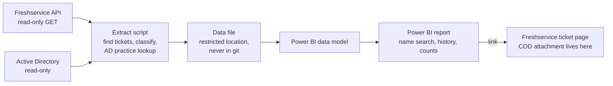

# Project Overview

> **This file must be updated with every change.** See [AGENTS.md](AGENTS.md#8-required-on-every-change).

**Last updated:** 2026-11-19

## Current status

**Phase:** Building, stage 1 (API discovery). The read-only API client, ticket-matching rules, and an API probe script are written and unit-tested with fake data. **The probe has not been run against Freshservice yet.** It has to be run as the ADM account. No Power BI report yet.

## Requirements summary

| # | Requirement | Priority | Status |
|---|---|---|---|
| R1 | Search by employee name | Must | Not started |
| R2 | Show request date and outcome (given / denied / pending) per request | Must | Not started |
| R3 | Pull De-Millimanize tickets from Freshservice (read-only), both form and legacy | Must | Not started |
| R4 | Total count of completed De-Millimanize tickets | Should | Not started |
| R5 | Flag repeat requests within a short window (e.g., 3 months) | Should | Not started |
| R6 | Requests by practice (visual) | Nice | Not started |
| R7 | Requests by device type (visual) | Nice | Not started |
| R8 | Link to the ticket's Certificate of Destruction | Nice | Not started |

## Architecture

**Chosen by Kevin (2026-11-19):** add a small extract script between Freshservice and Power BI.

Why the extract step is proposed:

- **API key:** The key is personal and stored in a Windows environment variable. Power BI can't read environment variables, but a script can.
- **Legacy tickets:** Finding them takes fuzzy matching and a review list. That's much easier to write and test in a script than in Power Query.
- **Practice:** It comes from an Active Directory lookup. `Get-ADUser` is available on the developer machine (checked 2026-11-19), and Power BI can't easily query AD without a gateway.

Trade-off: someone has to run the script, or schedule it on a machine, to refresh the data.

**Runtime:** Python 3.13 with the **standard library only**, so there are no packages to install. Python is installed machine-wide at `C:\Program Files\Python313` and is on the machine PATH, so the ADM account can use it too (checked 2026-11-19). `uv` isn't used because it's installed per-user and the ADM account can't reach it.

### Refreshing the data (decided 2026-11-19)

- **Scheduled:** Task Scheduler runs the extract **twice daily** as the ADM account. Not built yet.
- **Power BI Desktop Refresh button:** It reloads the latest data file. Power BI stays on the standard account.
- **"Run extract now" shortcut:** Runs the extract as the ADM account on demand, before clicking Refresh. Not built yet.

Power BI reports show the data from the **last refresh**. They don't fetch new data just because someone opens the report.

**API key and the ADM account:** The key is in the `FRESHSERVICE_API_KEY` **user** environment variable of the **Kevin.ConcepcionADM** account. Scripts that call the API must run as that account. Power BI does **not** need to.

**Project folder and the ADM account:** `O:\` is Kevin's home share (`\\milw-isilon-prod-smb.milliman.com\milwh-users$\kevin.concepcion`). Drive letters are per-user, so the ADM account has to use the **UNC path**. We still need to confirm the ADM account can read and write there; the probe will show this.

**Freshservice URL:** The API host is **`https://milliman-helpdesk.freshservice.com`**, confirmed from SPARK's source (`O:\Notes\SPARK Freshservice API Connection.md`). The first probe run used `https://hd.milliman.com`, which is the **portal** address, and got HTTP 404. That was the cause of the failure. The host can be overridden with `FRESHSERVICE_BASE_URL`. If the server redirects, the client stops and reports the target host, because following a redirect would send the API key to another server.

**First probe run (2026-11-19):** The launcher worked and the ADM account read `FRESHSERVICE_API_KEY`. The UNC path worked. The call failed with 404 because of the wrong host (see above).

**Lessons from the Spark project** (from SPARK's source, summarized in `O:\Notes\SPARK Freshservice API Connection.md`, branch `SPARK-PCR-KEVIN`):

- These GET paths work in SPARK: `/agents/me`, `/tickets/{id}`, `/tickets/{id}/requested_items` (form answers are under `custom_fields`), `/tickets/{id}/conversations?per_page=100&page=N`, `/requesters/{id}`, and `/departments/{id}`.
- **Practice:** SPARK treats the Freshservice **department name** as the practice. It follows ticket or requester `department_id` to `GET /departments/{id}`. That's a Freshservice-only option alongside AD; SPARK also has an AD organizational-unit lookup.
- **Status numbers SPARK uses:** 2 Open, 3 Pending, 4 Resolved, 6 Waiting on Customer, and 8 In Progress. The number for Closed isn't in SPARK, so the probe's status list will confirm it.
- SPARK's queries are limited to one agent and read only the first page. The dashboard needs all agents plus paging.
- Spark's API key could **submit** service requests but **couldn't read catalog definitions**. Our key may have similar read limits.
- Service-request custom field names get item-specific suffixes from Freshservice (for example `_252801`).

### Freshservice API facts (from official docs, api.freshservice.com, 2026-11-19)

- Authentication: HTTP Basic, with the API key as the username and `X` as the password.
- `GET /api/v2/tickets`: Returns only the **last 30 days** by default, so older tickets need `updated_since`. It can filter with `type=Service Request`. Up to `per_page=100` results per page, with the next page given in the `Link` header. Embedding extra data with `include` costs 2 extra API credits per resource.
- The list endpoint's predefined filters are `new_and_my_open`, `watching`, `spam`, and `deleted`. There is **no archived filter**, so whether archived tickets can be reached is still open. The probe tests this.
- `GET /api/v2/tickets/filter?query=...` can't search the subject. It returns a `total` count and 30 results per page.
- `GET /api/v2/tickets/[id]?include=conversations` returns up to 10 conversations. `include=ticket_attachments` returns attachment details.
- HTTP 429 means the rate limit was exceeded. The client waits for `Retry-After` and then retries.
- **Not yet confirmed (the probe checks these):** the exact paths for requested items (`/tickets/[id]/requested_items`), ticket fields (`/ticket_form_fields`), and agents (`/agents`).

- **Data source:** Freshservice API, read-only. Access was first set up through Spark.
- **Visualization:** Power BI. Power BI Desktop is installed on the developer machine (checked 2026-11-19).
- **Source format:** Power BI Project (`.pbip`) instead of `.pbix`, so the report is stored as text files that git can track and compare.
- **Authentication:** Microsoft sign-in through the Power BI Service. Only people the report is shared with can open it.
- **Certificates of Destruction:** The dashboard links to the Freshservice ticket, and the COD is opened there. The dashboard does not copy or store the PDFs.

## De-Millimanize policy (summary)

This comes from the internal IT policy note, last updated 2021.

- **Who can ask:** An employee whose old laptop is being replaced, or who is retiring or leaving Milliman. The program is **not advertised**.
- If the laptop is past warranty and going to a Milliman employee, the user needs **supervisor approval**.
- Requests from retiring EPs (SEAT) are approved.
- The laptop is fully wiped and has only the Windows operating system afterward.
- *Older guidance:* The employee may need to pay shipping to receive the laptop.

This is why Shannon wants to see repeat requests. Frequent asks from the same person go against the purpose of the program.

## Freshservice data (from ticket screenshots)

There are **two kinds** of De-Millimanize tickets.

### 1. Form-based tickets (current process)

| Item | What we saw |
|---|---|
| Ticket type | Service Request (`SR-` prefix) |
| Subject pattern | `Request for <Name> : "De-Millimanize" Device with Milliman Data` |
| Requested item | `"De-Millimanize" Device with Milliman Data` (service catalog item) |
| Form fields | PC Serial Number, PC Make and Model, Most recent PC Name, **Computer provided to** |
| COD | PDF attached to the ticket, named `Certificate-<OldPCName>-<ComputerID>-<SerialNumber>-<Status>-<YYYY-MM-DD>-<HH-mm-ss>.pdf` |
| Group / Department | CMH Health IT Support / CMH Health |
| Category | The procedure says *Ticket Management > User resolved issue*, but at least one ticket uses *Hardware > Laptop*. **Category is not reliable for filtering.** |
| Resolution notes | `Demillimanized laptop for <Name>` (by procedure) |

**Who received the device:** Use the **Computer provided to** field. The ticket's requester can be the IT technician who filed the form for someone else.

**Technician-listed tickets:** For charity devices, the procedure has the technician enter **their own name** in "Computer provided to." If that name matches a Freshservice **agent**, the ticket is placed in a separate **Technician-listed (possible charity)** category. It doesn't count toward that person's own request history. (Confirmed by Kevin, 2026-11-19.)

**Practice:** The form doesn't record it. For recipients who aren't technicians, practice comes from an **Active Directory lookup** of the recipient. Which AD attribute holds practice is still to be confirmed.

### 2. Legacy tickets (created before the form existed)

- These have no requested item and no form fields. They are free-text requests, for example "Demillimanize recent old laptop."
- The name has to come from the **requester**.
- Spelling varies ("Demillimanize", "De-Millimanize", "demillimanized"). **No single text rule finds all of them** (confirmed by Kevin, 2026-11-19). The plan is a matching method that flags *candidate* legacy tickets, shown as "Legacy: matched by keywords" so a person can review them. The method will be tested against known examples before anyone relies on it.
- Some have an **approval** (approver plus Approved status) attached.
- At least some are **Archived** in Freshservice. We still need to confirm whether the API returns archived tickets.

### Outcome mapping

| Source data | Dashboard outcome | Source |
|---|---|---|
| Status = Closed | **Completed (given)** | Confirmed by Kevin, 2026-11-19 |
| Any other status | **Not completed**, with the actual Freshservice status shown | No guessing. The real status is displayed. |
| Denial wording in a **private note** | **Possible denial: review** | Proposed. Never labeled "Denied" without a person checking it. |
| Legacy approval with a non-approved status | **Possible denial: review** | Proposed |
| Anything not recognized | **Unknown** | Per [AGENTS.md](AGENTS.md) rule 1.4 |

**Denials:** Kevin doesn't know of any denied request. A denied request probably never gets a form ticket, and any denial would most likely be recorded only in a ticket's **private notes**. So the dashboard can only *flag* possible denials, not count them for certain.

## Key decisions

| Date | Decision | Reason |
|---|---|---|
| 2026-11-19 | The dashboard is read-only against Freshservice | Reviewing ticket history doesn't require writing data, and read-only access lowers risk |
| 2026-11-19 | Use **Power BI** (not Grafana or a custom web app) | Already installed and part of Microsoft 365, so sign-in and sharing are built in. No server to host. Slicers handle name search. Grafana is designed for time-series monitoring and would need a server. |
| 2026-11-19 | Link to the COD on the Freshservice ticket instead of downloading it | CODs are already stored on the ticket. This avoids copying employee PDFs, and Freshservice attachment links expire. |
| 2026-11-19 | Identify the recipient with **Computer provided to** (form tickets) or the requester (legacy tickets) | The ticket requester is often the IT technician, not the employee who got the device |
| 2026-11-19 | COD link approach confirmed | Anyone with access to the ticket can view and download the COD, and Shannon has Freshservice access |
| 2026-11-19 | Technician-listed tickets get their own category | Charity devices are recorded under the technician's name and shouldn't count as that person's requests |
| 2026-11-19 | Only Closed counts as completed. Other statuses are shown as they are. | Confirmed by Kevin. Avoids guessing what other statuses mean. |
| 2026-11-19 | Denials are flagged for review, never auto-labeled | Denials are only recorded in free-text private notes, if at all |
| 2026-11-19 | Scheduled extract runs twice daily. Desktop Refresh reloads the file, and a separate "Run extract now" shortcut runs as ADM. | Chosen by Kevin. Keeps Power BI off the admin account. |
| 2026-11-19 | Extract uses the Python standard library only | Nothing to install, it works for the ADM account, and it keeps dependencies to a minimum (AGENTS.md rule 5.3) |
| 2026-11-19 | The API client is GET-only, https-only, refuses redirects, and only sends the key to the configured host | Enforces AGENTS.md section 2 and protects the API key |

## Open questions

1. **Power BI licensing:** This isn't a blocker for building, because Power BI Desktop is free. It needs to be revisited **before publishing**.
2. **ADM scheduled task:** Is IT policy OK with a scheduled task running under an ADM account? Long term, should refreshes use a dedicated service key?
3. **Archived tickets:** Can the API return them? Run the probe with an archived ticket number to check.
4. **Practice:** Which Active Directory attribute holds practice (for example `department`, `company`, or `division`)?
5. **Data file location:** It's in `data\` inside the project folder for now (git-ignored). It moves to the secure drive in a later stage.
6. **ADM access to the project folder:** Can the ADM account read and write Kevin's home share? The probe will show this.
7. **"Computer provided to" format:** Is it free text, an email address, or a user ID? The probe's requested-items output will show this, and it determines how the AD lookup works.
8. **Ticket links for Shannon:** Should ticket links use the portal address (`hd.milliman.com`) or `milliman-helpdesk.freshservice.com`? The portal address is probably the one people know.
9. **Practice source:** Should it be the Freshservice department name (as in SPARK), or AD?

## Change log

| Date | Author | Change |
|---|---|---|
| 2026-11-19 | Kevin Concepcion (with AI agent) | Created README.md, AGENTS.md, and OVERVIEW.md |
| 2026-11-19 | Kevin Concepcion (with AI agent) | Chose Power BI. Documented the Freshservice ticket structure (form and legacy), the draft status mapping, and the COD approach. Updated open questions. |
| 2026-11-19 | Kevin Concepcion (with AI agent) | Added the policy summary, recorded answers on denials, the technician/charity category, Closed status, the personal API key, COD access, legacy detection, and AD practice lookup. Proposed an extract-script architecture. Reset the open questions. |
| 2026-11-19 | Kevin Concepcion (with AI agent) | Restored AGENTS.md (accidentally emptied, never committed) with its original content. Documented refresh options, the API key's location under the ADM account, and the licensing note. |
| 2026-11-19 | Kevin Concepcion (with AI agent) | Stage 1: added `.gitignore`, `.env.example`, the read-only API client (`extract/freshservice.py`), the matching rules (`extract/classify.py`), the probe (`extract/probe.py` and `tools/probe.cmd`), and unit tests. **Tested:** 16 unit tests pass (fake data). The probe stops cleanly on the standard account with no key. **Not tested:** any live API call. |
| 2026-11-19 | Kevin Concepcion (with AI agent) | Fixed the probe launcher. "Run as different user" did nothing, because the ADM account has no `O:` drive. `probe.cmd` now finds the folder's UNC path (`run.py unc`) and uses `runas` to start the probe as the ADM account, which loads its profile so `FRESHSERVICE_API_KEY` is available. **Tested:** UNC lookup returns the correct path, and tests still pass. **Not tested:** the `runas` step, which needs the ADM password. |
| 2026-11-19 | Kevin Concepcion (with AI agent) | First live probe run: the launcher, the ADM key, and the UNC path all worked, but `hd.milliman.com` returned 404 for the API. Reviewed Spark's notes for Freshservice lessons (read-permission limits, field-name suffixes, Okta for practice). |
| 2026-11-19 | Kevin Concepcion (with AI agent) | Found the cause of the 404: wrong host. Switched the default API host to `milliman-helpdesk.freshservice.com`, as used by SPARK. Added an `agents/me` key check to the probe. **Tested:** the config resolves the new host, and 16 unit tests pass. **Not tested:** a live probe against the new host. |
